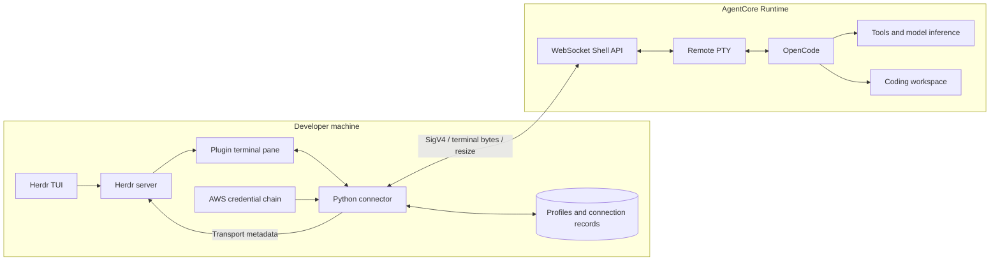
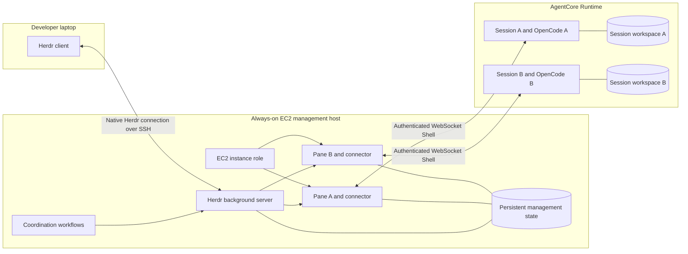
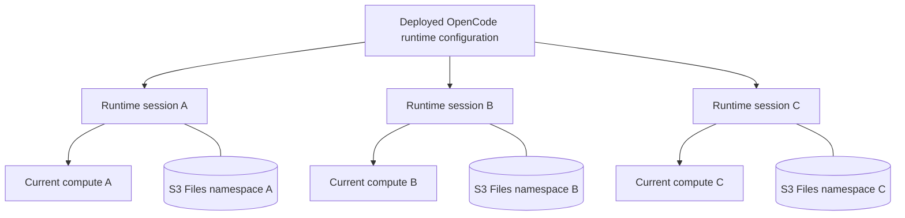
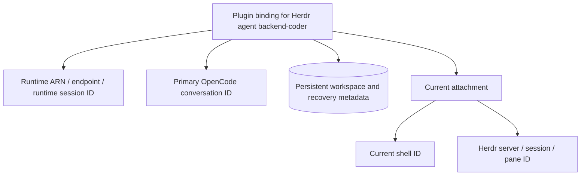
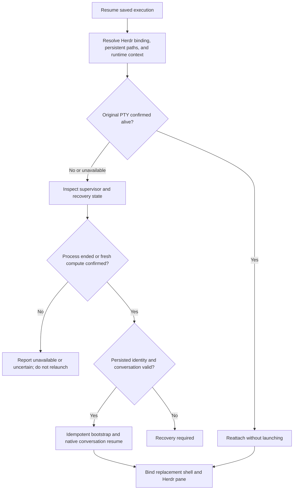
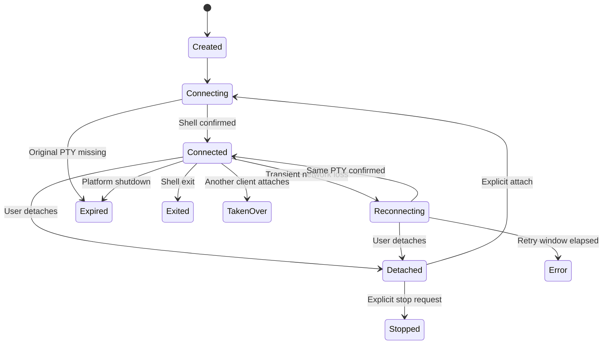

# Design

## Central decision and implementation status

**Herdr owns workspaces, tabs, panes, and live agent identity. The plugin binds those primitives to AgentCore execution and persistent coding files.** A durable plugin binding supports recovery without introducing a separate end-user platform or replacing Herdr's agent model.

The current prototype creates agents, reattaches surviving PTYs, detaches, and explicitly stops compute. The lifecycle target extends this with persisted conversation identity, process restart, and recovery onto fresh compute. Sections labeled **target** describe planned work; they do not change the current connector's conservative behavior when the original PTY is missing.

The repository also owns the OpenCode runtime image and an explicit `provision` CLI workflow. Existing external runtimes remain supported. Provisioning is a separate deployment operation; opening a pane uses an existing deployment rather than building infrastructure per agent.

### Scope of the Jindouyun comparison

Jindouyun is a reference for missing execution concepts: persistent coding files, remote Working Directories, multiple shells, skills, and process/conversation recovery. It is not a required backend. This plugin does not adopt Cognito, per-user account ownership, a customer-facing Runtime catalog, DynamoDB registries, or the proposed `agentcore-code` CLI.

| Layer | Responsibility |
| --- | --- |
| Herdr | Layout, live agent identities/names, terminal presentation, prompt/read/wait/key APIs, and orchestration by scripts or agents using those APIs. |
| Plugin | AgentCore runtime selection, remote execution bindings, shell transport, persistent paths, lifecycle actions, and recovery metadata. |
| AgentCore runtime | Isolated compute, coding-agent/tool execution, mounted files, and runtime-side process supervision/health. |
| AWS IAM and host access | Direct AgentCore authorization through the management host's credentials/role, plus Herdr's existing local/SSH access model. |

The default remains one runtime session and one shell per independently isolated agent. Additional helper or agent shells within an existing runtime session are a planned extension; one-agent-per-session is not a universal identity rule.

**Deployment decision:** for management that continues while the laptop sleeps or reboots, run the Herdr background server, connectors, and coordinating workflows on an always-on cloud host. Start with one EC2 host and Herdr's native SSH remote-machine support. Keep the laptop as a client and OpenCode execution in AgentCore. This cloud deployment has not yet been validated.

## Architecture

Each server-owned Herdr pane hosts a connector on the same machine as the Herdr server. The connector uses AgentCore's authenticated WebSocket Shell API to access a remote PTY running OpenCode. Here, "host-local" means local to the management server, which can be a laptop or a cloud host.

### Laptop-hosted development mode



One deployed runtime ARN can serve multiple runtime sessions. The plugin creates a separate runtime session for each new independent coding environment.

### Cloud-hosted management — recommended target



The SSH connection and AgentCore WebSockets have independent owners. Closing the laptop connection leaves the EC2 server and connectors running. Laptop-side controls and live viewing pause until reconnect; cloud-side workflows can continue if they actually run on the management host or another cloud service.

Install Herdr, the plugin, Python/uv dependencies, and runtime profiles on the EC2 host. Herdr's remote-machine connection does not copy local plugins or configuration there. With an existing SSH host alias, the laptop can register the server using the standard command:

```bash
herdr machine add cloudbox
```

This is a setup example, not a command already executed or a deployed resource. The profile selects a remote Herdr session. Agent/pane IDs belong to that remote server; automation should use the corresponding `herdr --machine <saved-profile>` routing when invoked from the laptop.

### EC2 versus ECS

| Concern | EC2 — first deployment | ECS — alternative |
| --- | --- | --- |
| Remote client access | Existing SSH access fits Herdr's saved-machine transport. | Provide an SSH endpoint or another compatible bridge; ECS Exec is not assumed to implement the transport. |
| Long-running management | Supervise the Herdr server with a service manager such as systemd. | An ECS service maintains task availability, but task replacement terminates the old server/connectors. |
| Durable state | Retained EBS-backed storage with explicit retention, backup, and reattachment policies. | External persistent storage, for example EFS, with validated filesystem/locking behavior. |
| AWS authentication | Instance-role credentials resolved through the normal AWS credential chain. | Task-role credentials resolved through the normal AWS credential chain. |
| Replacement recovery | Reconcile registry state after a host/server restart. | Reconcile after every task replacement or deployment that replaces the task. |
| Initial effort | Lower; uses Herdr's existing host model. | Higher; remote access, task identity, and state recovery need additional design and validation. |

Start with one active management host. An additional host is not automatically safe failover: controller leases and idempotent workflow recovery are needed before two hosts can control the same remote execution. The existing process lock is only a local attachment guard, not a distributed coordination mechanism. This concerns process coordination, not end-user account management.

### Management-host state and credentials

Persist Herdr configuration and saved session/layout state, the plugin's config directory, and its execution-binding records on the management host. Installation trees remain replaceable. Keep live IPC sockets and process-specific files on the host's local runtime filesystem. Persisted state must be reachable after the planned host replacement; a volume's mere existence is not a recovery policy.

The connector uses the management host's instance role for AgentCore access. OpenCode uses its AgentCore execution role for model/tools access. Laptop SSH authentication is a third, separate boundary. Do not require an active laptop credential-forwarding process to keep the cloud connectors authorized.

Configure the service manager to start Herdr with the intended service user, environment, and persistent session. Starting the daemon restores service availability; automatic recovery of plugin connections and coordination progress requires an additional reconciliation workflow, which is not implemented yet.

### Failure boundaries and expected behavior

| Event | Expected behavior |
| --- | --- |
| Herdr client closes or laptop sleeps/reboots | SSH/viewing ends; cloud server, connectors, and cloud-side coordination continue while their hosts are healthy. Do not issue runtime stop merely because a viewer disappears. |
| Laptop-hosted development mode loses connectivity | Its connectors cannot make progress while asleep; remote work may continue subject to shell/runtime lifetimes. This mode does not provide unattended management. |
| EC2 management host or ECS task restarts | Connectors and sockets are lost. Load retained registry state, inspect remote sessions, and reattach/recover without replaying uncertain work. Automatic reconciliation is planned. |
| AgentCore shell disappears | Apply strict attach versus explicit process recovery semantics, independent of the management host's health. |
| AgentCore compute expires or stops | Recover workspace/conversation state onto fresh compute according to the resume contract. An always-on Herdr host does not remove AgentCore lifetime limits. |
| A coordinating workflow crashes | Recover its own durable progress. Herdr process supervision alone does not restore workflow execution state. |

There are two recovery mechanisms to implement: **management-host recovery** restores registry, connections, and coordination; **AgentCore recovery** restores coding workspace/conversation state. Validate them separately and together. Remote activity can continue to consume cloud resources while no laptop is attached.

### Runtime fleet and session allocation

The fleet is the collection of session sandboxes created from a deployed runtime configuration. Normally deploy one runtime per environment configuration, not one runtime per pane. Different images, permissions, or network configurations can use separate runtime profiles.



The storage branches represent separate persistent-home namespaces for independent executions on the configured S3 Files filesystem. They do not require a separate storage service or per-user access-point provisioning. AgentCore manages compute allocation. The plugin keeps Herdr-to-AgentCore bindings, creates session IDs, and manages connections and lifecycle operations. Infrastructure provisioning remains separately configured.

New UUID session IDs create independent compute environments. Persistent files have a separate lifecycle. The plugin should allocate a fresh home namespace for new independent work by default, but permit deliberate use of an existing Working Directory or shared files. Directory namespaces prevent accidental overlap; they are not additional IAM security boundaries.

## Component responsibilities

| Component | Responsibility |
| --- | --- |
| `herdr-plugin.toml` | Declare build steps, actions, and terminal pane entrypoints. |
| `src/herdr_agentcore/cli.py` | Parse commands; present setup/session menus; coordinate new, attach, and stop workflows. |
| `src/herdr_agentcore/provision.py` | Generate CloudFormation definitions, build/push the pinned ARM64 image, create/update owned infrastructure/runtime stacks, and register the resulting connector profile. |
| `src/herdr_agentcore/runtime_image/` | Tracked image build context: OpenCode installation, `/app/run.sh`, role-provider bootstrap, OpenCode configuration, HTTP health endpoint, and upstream notices. |
| `src/herdr_agentcore/herdr.py` | Invoke public Herdr APIs and report transport metadata. |
| `src/herdr_agentcore/storage.py` | Validate profiles and records; persist state atomically; enforce local attachment locks. |
| `src/herdr_agentcore/connector.py` | Sign connections, interpret shell frames, launch once, reconnect, and handle termination. |
| `src/herdr_agentcore/runtime_aws.py` | Build an opt-in launcher shim that removes static runtime credentials after sample initialization and selects OpenCode's expiration-aware provider chain. |
| `src/herdr_agentcore/terminal.py` | Manage POSIX raw mode, bounded input, detach keys, and resize notifications. |
| `src/tests/` | Offline behavior tests and optional isolated Herdr manifest validation. |

## Repository-owned runtime and provisioning

`herdr-agentcore provision` provides the deployment path alongside the connector. It adapts the OpenCode portion of `awslabs/agentcore-samples`; provenance and Apache-2.0 notices are included in the repository, distribution, and image. The ignored upstream checkout is no longer needed to build this runtime. The standalone image supplies local coding tools without requiring the sample's GitHub gateway or shared deployment files.

### Deployment sequence

1. Validate the runtime name, region, model ID, pinned OpenCode version, and destination profile. `--plan` prints both templates without Docker/AWS calls or configuration writes.
2. Check the local Docker engine/Buildx and inspect both CloudFormation stacks before mutation. Stack tags identify the deployment; existing stacks require `--update`, and unrelated or unstable stacks are rejected.
3. Create/update `herdr-<name>-image`, containing ECR and an AgentCore execution role. Runtime-name underscores become hyphens in stack names. Trust is constrained to the account and matching regional runtime. Permissions cover the repository pull, runtime logs, and the selected Bedrock model plus its geographic system inference profiles.
4. Build `linux/arm64` with a pinned OpenCode release, push under a unique immutable tag, and resolve the image digest. Docker's ECR login uses a temporary configuration and stdin, never runtime credentials or build arguments. Preserve Docker Desktop plugin discovery while keeping its stored logins separate.
5. Create/update `herdr-<name>-runtime` with `AWS::BedrockAgentCore::Runtime`, the execution role, and the digest-pinned image. Runtime access uses IAM (no JWT authorizer). The current template uses `PUBLIC` networking, HTTP health endpoints, a 900-second idle timeout, and a 28,800-second maximum lifetime.
6. Wait for CloudFormation completion, then save the runtime ARN as a normal connector profile with `/app/run.sh`. `--replace` is required to replace a profile. No compatibility credential shim is needed for the owned image. Provisioning does not create an agent session; the existing Herdr new-agent action does that.

The deployment identity uses the management host's normal AWS chain/optional `--aws-profile`, including ECR upload and CloudFormation/IAM/PassRole/AgentCore permissions. The runtime execution role grants model access independently. The configured model must be available to the account/region. Foundation-model IDs and geographic system inference-profile IDs are supported; arbitrary application inference-profile ARNs need additional policy/configuration support. Primary and small-model tasks use the same configured model to keep authorization aligned.

### Runtime bootstrap and authentication

The image installs OpenCode 1.18.30 by default and verifies its version during the build. The runtime HTTP process runs as an unprivileged user. `/app/run.sh` executes `launch.py`, which passes native OpenCode arguments through unchanged (including `--session`). It chooses `OPENCODE_WORKDIR` or the existing `HOME`; it does not overwrite user configuration or insert permissive tool-approval settings. Both the image and launcher set `OPENCODE_DISABLE_AUTOUPDATE=1`: OpenCode's updater reads global configuration, so `autoupdate: false` in the runtime's additional config file alone does not reliably suppress the startup update dialog.

`/app/opencode.json` supplies the Bedrock provider/region/model through `OPENCODE_CONFIG`. The launcher sets `AWS_PROFILE=default` to select OpenCode's expiration-aware Node provider chain. With no credential files or injected keys in this image, the chain resolves the AgentCore execution role and refreshes temporary credentials internally. There are no manual IMDS fetches, access-key exports, bearer tokens, or credential snapshots. Only allowlisted non-secret deployment settings are inherited from PID 1 when the shell omits them.

The HTTP server reports `Healthy` liveness without fabricating workload timestamps. It is not a workload supervisor; idle/max-lifetime limits still apply. The included deployment currently uses ephemeral coding state and does not mount S3 Files. Persistent-home namespaces, mount/VPC provisioning, process-aware busy reporting, and automatic resume remain the next increments.

### Updates, failures, and cleanup

Rerun with `--update --replace` to update the deployment and its existing connector profile. Every build gets a unique tag and the runtime uses its digest. This does not restart existing OpenCode processes or retrofit their environment; use new sessions to validate a new image. Changing model authorization can affect existing sessions using that role.

CloudFormation operations use bounded waits and retain observable stack state on errors. A build/push failure can leave the image stack ready; retry with `--update`. A rollback-complete failed creation must be inspected/deleted in CloudFormation before retrying. A failure after runtime creation but before profile saving leaves a deployed runtime: recover its `RuntimeArn` stack output and configure the connector rather than creating another deployment. No automatic destructive cleanup runs on ambiguous failures.

For deliberate teardown, stop the deployment's sessions, delete the `herdr-<name>-runtime` stack and wait for deletion, then delete `herdr-<name>-image`. ECR is retained by policy; retrieve `RepositoryName` from the image stack outputs before deletion and remove that repository separately when its images are no longer needed. Remove the corresponding connector profile separately. Deleting stacks is distinct from the plugin's session-stop action.

Local validation covers the actual ARM64 image/OpenCode configuration, HTTP contract, bootstrap argv and configuration preservation, offline plan, scoped IAM template generation, ownership/update guards, bounded failure handling, profile registration, and temporary Docker credential storage. Both generated templates passed `cfn-lint`.

AWS provisioning subsequently passed, including infrastructure creation, ECR push, runtime creation, connector-profile registration, and a digest-pinned image update. The initial live probe exposed an update dialog that Herdr classified as idle; the test's Enter went to the dialog rather than a model prompt. That disposable session was stopped. The launcher now disables the updater explicitly, and the live probe rejects known update screens before submitting a prompt.

After the image update, `live_herdr_smoke.py --check-runtime-role` passed against the owned deployment using `/app/run.sh` directly: a real Bedrock response, process inspection confirming no static credential variables and no compatibility shim, detach/reattach to the same session, a context-aware follow-up, and explicit test-session stop. The isolated Herdr server was also stopped. Deployment identifiers and the registered user profile remain outside the repository. Real credential rollover across a complete token lifetime remains unverified.

## Herdr integration

The plugin defines five actions and corresponding pane entrypoints:

- `agentcore.setup`: configure a runtime profile.
- `agentcore.new`: choose a profile and start a cloud agent.
- `agentcore.attach`: reattach a saved connection.
- `agentcore.sessions`: show last-known connection records.
- `agentcore.stop`: explicitly stop compute for a detached runtime session.

Actions open panes using `herdr plugin pane open` with an explicit target from the invocation context. Actions and connectors execute on the selected Herdr server host. The connector is re-executed with `HERDR_AGENT=opencode` so that server can identify its host-local wrapper and use its OpenCode screen manifest.

Agent lifecycle remains screen-derived. The connector separately reports `cloud` and `connection` metadata tokens. A connected transport does not imply an idle agent, and cached screen content during an outage is not live lifecycle evidence.

An event-based lifecycle bridge is a follow-up: the standard OpenCode integration talks to a host-local Herdr socket, which is not directly reachable from an AgentCore microVM even when Herdr itself runs on EC2.

### Herdr-native orchestration

Use plugin/pane actions to provision or attach remote execution, then use Herdr's existing `agent list`, `agent prompt`, `agent read`, `agent wait`, and `agent send-keys` surfaces once the agent is recognized. `agent start --kind opencode` selects the canonical executable; it is not an AgentCore provisioning API.

A coordinating script or agent on the management host can drive multiple cloud-agent panes through these APIs. The plugin supplies execution and lifecycle support rather than a new workflow/control-plane service. Cloud workers do not automatically gain access to the management host's Herdr socket; a narrowly scoped bridge would be separate future work if workers need to issue Herdr commands directly.

### Additional shells and operation scope — target

Each pane binds to one remote shell. An AgentCore runtime session may have several agent/helper shells; each agent shell can have its own OpenCode conversation. Workspace/tab grouping remains Herdr presentation and does not create new backend Project or User resources.

```text
Herdr workspace/tab
  Pane: implementation → runtime session A / shell 1 → OpenCode conversation 1
  Pane: tests          → runtime session A / shell 2 → ordinary build/test shell
  Pane: reviewer       → runtime session B / shell 3 → OpenCode conversation 2
```

Only actual agent panes receive `HERDR_AGENT=opencode`. An ordinary helper shell must remain a normal Herdr terminal. Detach disconnects a pane; stopping a shell/process affects that execution; stopping a runtime session affects all its shells. Before adding shared-session shells, implement explicit stop scopes and sibling-impact reporting. The current stop action targets the runtime session.

## Agent identity and storage

| Identity | Lifetime and meaning |
| --- | --- |
| Plugin execution-binding ID | Stable internal handle for remote execution and recovery. Reuse the current connection UUID; this is not a new end-user or platform agent resource. |
| AgentCore runtime-session ID | Identifies the session/environment context within its runtime; retain it across supported stop/resume cycles. |
| AgentCore shell ID | Identifies a PTY lifetime. Reuse it for warm reattachment; replace it for an explicit process/compute recovery. |
| OpenCode conversation ID | Identifies the primary conversation to resume from persisted state; not yet captured by this plugin. |
| Herdr server/session and pane ID | Current attachment on the management host. Pane IDs are scoped to one server and can change on replacement/movement. |
| Herdr agent name | A convenient live alias, not a durable identity. Restore the desired display name subject to local uniqueness. |

Profiles are stored in `HERDR_PLUGIN_CONFIG_DIR/config.json`. Connection records and locks are stored under `HERDR_PLUGIN_STATE_DIR`. In cloud-hosted mode, these paths belong to the EC2/ECS management host, not the viewing laptop. Standalone CLI use has separate XDG defaults and explicit directory overrides.

A current connection record snapshots its profile, both remote IDs, launch state, last-known transport status, and timestamps. Editing a profile therefore affects new connections only. Config and record formats use `version: 1`; record writes use an atomic replacement and a local per-connection lock.

### Target execution-binding records

Extend that record through a versioned migration to include the active OpenCode conversation ID, S3 Files persistent-home and remote Working Directory paths, bootstrap metadata, runtime-version compatibility information, desired Herdr name, and current attachment. Runtime ARN, endpoint, and session ID must be resolved together; a session ID alone is not a portable identity across deployments. Host-local records remain the initial store; no cloud customer-registry service is required.



For example, execution displayed as `backend-coder` can move from shell X and pane `w1:p2` to shell Y and pane `w1:p7` while retaining its binding ID, persistent paths, runtime session ID, and conversation. Herdr may clear a live alias when the connector exits; the plugin must explicitly rebind and reapply its desired name after recognition, respecting live-name uniqueness. Saved execution may exist without an attached pane.

When attaching an existing session, resolve its configured runtime context and stored shell/conversation mapping. Unknown IDs need an explicit adoption/discovery flow; do not guess the PTY or claim to have resumed a conversation. IAM controls AWS access. Locks and any future controller leases prevent competing connectors/recovery; they do not implement end-user identity or authorization.

## Persistent coding files through S3 Files

**Primary target:** an S3 Files access point mounted by the AgentCore runtime. Reuse the sample's `/mnt/s3files` mount when appropriate; the access point and mount path are deployment configuration, not Cognito-derived resources. Example configuration shape:

```json
{
  "filesystemConfigurations": [
    {
      "s3FilesAccessPoint": {
        "accessPointArn": "<configured-s3-files-access-point-arn>",
        "mountPath": "/mnt/s3files"
      }
    }
  ]
}
```

```text
/mnt/s3files/
  mcp/                                   Existing shared tools, if configured
  herdr/<execution-binding-id>/home/
    src/my-repo/                         Files, .git, and uncommitted work
    .config/opencode/                    Persistent agent configuration
    .local/share/opencode/               Conversation/application state
    .herdr-agentcore/skills/             Configured persistent skills
    .herdr-agentcore/recovery/           Paths and conversation mappings
    artifacts/                          Selected build/task results
```

The layout is proposed. Configure `HOME` or supported tool/OpenCode data directories to point at the persistent home, while keeping installed executables reachable independently of `HOME`. Configure and test skill discovery for the selected OpenCode version; placing files in a directory alone does not establish discovery.

Persist the selected home and Working Directory in the binding record. Launch in that remote directory, which may be an existing repository; it is independent of the local Herdr pane's cwd. Reconnect and replacement compute reuse the same paths. Additional shells may intentionally share files, with separate directories/worktrees or other explicit coordination for concurrent editing.

### Bootstrap and filesystem behavior

- Verify the configured mount and persistent path before launching. A failed mount must not silently redirect work to ephemeral storage.
- Initialize a new home's defaults once. Preserve existing configuration, files, and conversation state on later launches.
- Replace the sample launcher's hardcoded `/home/agent`, forced `cd "$HOME"`, and unconditional OpenCode config rewrite with explicit persistent-home/cwd handling.
- Validate OpenCode database behavior on S3 Files, including locking, crash recovery, and concurrent access. Do not assume network-mounted storage has identical semantics to a local disk; this is a release gate for conversation persistence.
- Keep sockets, PIDs, runtime leases, and other process-specific state on an appropriate ephemeral filesystem. Filesystem persistence does not restore processes, locks, or memory.
- Record and verify OpenCode conversation/recovery metadata before process replacement. Coordinate concurrent bootstrap attempts so they cannot launch duplicate agents.

S3 Files requires the runtime's VPC/mount connectivity, permissions, and POSIX access-point identity to be configured correctly. Provisioning remains a deployment concern; the plugin consumes the configured mount. Its persistent files survive compute replacement according to the customer-managed filesystem and backing-storage lifecycle. Detach, session stop, and plugin uninstall do not mean file deletion. Backups, retention, and format migrations must be deliberate.

Managed per-session storage Preview is a possible later alternative, not the primary contract. Its documented per-session isolation, 14-day inactivity expiry, and reset on runtime-version updates differ from S3 Files persistence and must be evaluated explicitly before use.

The microVM's default idle timeout is 15 minutes and its maximum compute lifetime is 8 hours. Those limits govern each compute incarnation; persistent files have their own lifecycle. The current prototype does not yet configure persistent home/cwd, capture conversation IDs, or validate this filesystem layout.

## Resume semantics — target

| Situation | Required action | Identity preserved |
| --- | --- | --- |
| Original PTY and OpenCode process survive | Reattach using the existing runtime-session/shell pair; send no launch command. | Execution binding, runtime session, shell, conversation. |
| Compute survives but the original PTY is unavailable | Inspect runtime-side process supervision; attach a replacement shell to surviving work where possible, otherwise explicitly resume the saved conversation after confirming process exit. | Binding, runtime session, persistent paths/conversation; shell changes. |
| Compute has stopped | Reuse the runtime session ID, remount S3 Files on fresh compute, validate saved paths/metadata, and resume OpenCode in a new shell. | Binding, runtime session, persistent files/conversation; compute and shell change. |
| Storage is missing or incompatible | Enter recovery-required state and require explicit migration/reset. | Preserve binding and failure information; do not claim successful resume. |

Process/compute recovery is an explicit operation, not a reconnect retry. It restores saved files and conversation state, not an arbitrary instruction pointer, running subprocess, or in-flight tool call. A dropped socket is insufficient evidence that the agent process died.

A runtime-side supervisor or named `tmux` session can keep work independent of one AgentCore shell attachment while compute survives. Evaluate that execution pattern as part of recovery; it is not currently installed by the plugin and cannot preserve processes across compute termination.



### User-facing lifecycle operations

| Operation | Contract | Current implementation |
| --- | --- | --- |
| New | Create an execution binding/session and initialize its persistent home or deliberately select existing project files. | New remote IDs and launch implemented; persistent-home/cwd integration pending. |
| Attach | Reattach only to the original live PTY. | Implemented. |
| Detach | Disconnect local terminal; leave remote compute subject to platform lifecycle policies. | Implemented. |
| Stop runtime session | Terminate its compute and all shells, retaining binding records and persistent files. | Stop API implemented; the prototype currently prevents reattaching stopped records. |
| Stop shell/process | Stop only the selected execution; preserve sibling shells and persistent files. | Planned alongside additional-shell support. |
| Resume | Reattach if alive, otherwise explicitly recover process/compute from persisted state. | Planned. |
| Archive | Mark logical work finished and retain/export results according to policy. Data deletion is a separate decision. | Planned; not an AgentCore stop operation. |

The new resume path must make stopped/expired execution recoverable through its saved binding while retaining strict attach behavior. Retry `RetryableConflictException`/retryable HTTP 409 responses during provisioning and stop with bounded backoff; do not treat every conflict as a successful operation or relaunch an ambiguous request. The current WebSocket connector treats non-429 HTTP 4xx responses as terminal, so retryable lifecycle conflict handling is an implementation gap.

### Independent state dimensions

| Dimension | Example states | Authority |
| --- | --- | --- |
| Compute | running, stopped, recovering, unknown | AgentCore operations and runtime supervisor; local records are last-known observations. |
| Connection | attached, detached, reconnecting | Local connector. |
| Agent work | working, idle, blocked, unknown | Current screen detection; future remote OpenCode event bridge. |

Do not conflate `idle` with stopped compute, or detachment with task completion. The runtime supervisor should report actual active/background work through AgentCore health responses (`HealthyBusy` when appropriate). WebSocket keepalive is a transport mechanism, not a substitute for workload tracking or a way to bypass maximum compute lifetime. The sample's always-`Healthy` handler does not implement this supervisor.

## Current launch and reattach sequence

```mermaid
sequenceDiagram
    actor User
    participant Herdr
    participant Connector
    participant Store
    participant Shell as AgentCore Shell
    User->>Herdr: New agent or attach
    Herdr->>Connector: Open plugin pane
    Connector->>Store: Create/load record and acquire lock
    Connector->>Shell: Signed WebSocket connection with both IDs
    Shell-->>Connector: Confirm shell ID and reconnected flag
    alt Launch not yet attempted
        Connector->>Store: Persist launch_state = attempted
        Connector->>Shell: Send remote launch argv once
        Connector->>Store: Persist launch_state = sent
    else Existing PTY confirmed
        Note over Connector,Shell: Reattach without replaying the launch
    else Original PTY missing
        Connector->>Store: Mark expired
        Connector-->>User: Stop; explicit recovery required
    end
    loop While connected
        Herdr->>Connector: Input or resize
        Connector->>Shell: STDIN or RESIZE frame
        Shell-->>Connector: Terminal output
        Connector-->>Herdr: Output bytes and connection metadata
    end
```

The default remote argv is `["/app/run.sh"]`, supported by both the owned image and the AWS sample. Arguments are shell-quoted individually and launched with `exec env TERM=xterm-256color COLORTERM=truecolor ...`. The explicit provisioning CLI creates infrastructure and model authorization; the remote launcher configures the OpenCode process.

### Opt-in runtime-role credential provider

This compatibility path applies to external upstream-sample images. The repository-owned launcher already uses the role provider directly and does not need the shim.

`configure --runtime-role-credentials` and the corresponding setup-menu option wrap the configured launch argv. The default remains opt-out for compatibility with other runtime authentication setups. The wrapper resolves the installed OpenCode executable, creates a private temporary `opencode` shim, prepends its directory to `PATH`, and runs the original launcher. When the launcher invokes `opencode`, the shim clears `AWS_ACCESS_KEY_ID`, `AWS_SECRET_ACCESS_KEY`, `AWS_SESSION_TOKEN`, and `AWS_SECURITY_TOKEN`, sets `AWS_PROFILE=default`, and execs the original executable with the supplied arguments.

Clearing credentials **after** initialization matters: the sample fetches and exports a static IMDS credential snapshot during `/app/run.sh`. Merely unsetting variables before that script would allow it to restore the snapshot. The shim retains the launcher's generated region/model/MCP configuration. In OpenCode 1.18.30, selecting an AWS profile activates the Node credential provider chain; on the verified runtime, the default chain resolves execution-role credentials with expiration metadata.

The profile's `aws_profile` still selects management-host credentials for AgentCore API calls. The runtime's `AWS_PROFILE=default` is independent. The wrapped command is saved as ordinary version-1 profile argv, so existing connection snapshots are unchanged and no credentials are persisted. Original argv is validated before wrapping, and the resulting command must still meet profile length/control-character limits.

This option requires an already-installed OpenCode binary and a launcher that preserves the shim's precedence in `PATH`. An absolute OpenCode invocation bypasses it. Default-profile credentials from a file or other source, explicit provider credentials, and Bedrock API keys can select different authentication; use the option only where the runtime's default chain resolves its intended execution role. The temporary shim lives in ephemeral runtime storage. Automatic process repair and full credential-lifetime validation are separate work.

## Current connector transport and lifecycle behavior



- Use the SDK to generate a freshly signed shell connection; process WebSocket frames directly so connection confirmation and `reconnected` are visible.
- Forward output bytes without decoding/re-encoding the terminal stream. Input chunks remain below the shell frame-size limit.
- Forward initial dimensions, `SIGWINCH` updates, and dimensions after reconnect.
- Persist `attempted` before sending the launch. If delivery is uncertain, show the existing terminal rather than repeating the command.
- Discard input during an outage. If an input send fails ambiguously, end the connector rather than resubmit it.
- A second local connector is rejected by the lock. Remote takeover closes the displaced connection without a reconnect loop.
- Ctrl+] followed by `d` detaches; Ctrl+] twice sends a literal prefix. Detach closes the WebSocket without the shell-shutdown frame.
- Stop calls `StopRuntimeSession` after explicit confirmation and successful local lock acquisition. It affects the whole remote runtime session.

AgentCore microVM lifetime and idle limits still apply. Reattaching after expiry can reach a fresh environment; that must not be mistaken for the original agent. The sample's shared storage mount does not automatically persist OpenCode conversation state.

### Deployed session lifecycle

The owned runtime's control-plane configuration was verified as `idleRuntimeSessionTimeout: 900`, `maxLifetime: 28800`, with no filesystem configurations. These are the values explicitly generated by `runtime_template()` in `src/herdr_agentcore/provision.py`, not just assumed service defaults.

- **Idle:** 15 minutes of platform-determined inactivity triggers compute termination. AgentCore documents invocation activity and `HealthyBusy` workload reporting as relevant to idle accounting. The precise effects of interactive Shell traffic on that accounting have not been validated here.
- **Maximum lifetime:** 8 hours from that compute instance's creation. Activity, reconnects, and refreshed IAM credentials do not reset the maximum-lifetime clock. Termination can take up to 15 seconds after a threshold is reached.
- **Scope:** each independent agent session has its own compute and timers. Termination does not delete the runtime deployment, image, execution role, or host-local connection record. The deployment can still provision new sessions.
- **Detach versus stop:** detach closes only the terminal connection. Explicit `StopRuntimeSession` terminates the selected session's compute and all its processes. The current stop path records an accepted request; it has no completion waiter or automatic resume workflow.
- **Data:** the current image uses ephemeral home/workspace/OpenCode state. Without S3 Files or another configured persistent filesystem, those files and conversation data must not be expected to survive compute termination. Retaining a connection UUID or reusing a runtime session ID does not reconstruct them.

The current `runtime_image/healthcheck.py` returns `{"status": "Healthy"}` for every `/ping`. It neither observes OpenCode work nor emits `HealthyBusy`. Consequently, liveness, a connected WebSocket, and Herdr's screen-derived status do not establish workload-aware protection against idle shutdown. This is a known implementation gap, not a claim that an agent can safely execute for eight uninterrupted hours.

The follow-up supervisor must report actual active/background work, return to `Healthy` when idle, and omit `time_of_last_update` or change it only on real status transitions. It must not manufacture activity to defeat idle cleanup. Pair that work with persistent coding state and explicit process/compute recovery before claiming reliable unattended operation. Full idle-expiry and maximum-lifetime recovery tests remain pending.

## Implementation increments

1. Extend the verified single-agent and five-agent workflows to the remaining durable orchestration, dialog, network-outage, and pane-layout acceptance cases.
2. Extend host-local execution bindings with S3 Files persistent-home/cwd and conversation metadata, keeping existing records readable through migration.
3. Integrate the configured S3 Files mount and runtime-side persistent-home bootstrap/process supervision; validate repositories, configuration, skills, and OpenCode database persistence.
4. Establish the single-EC2 management deployment: supervised Herdr, host-installed plugin, instance role, persistent management state, and laptop SSH attachment. Test laptop sleep/reboot while agents are running.
5. Add explicit resume, Herdr rebinding, management-host reconciliation, and retryable lifecycle conflicts. Add helper/agent shell panes in existing sessions with separate shell-stop versus session-stop semantics.
6. Test persistent files, selected Working Directories, multiple shells, process restart, compute stop/resume, management-host replacement, and competing recovery attempts.

Management-host deployment remains separately configured; the repository now supplies runtime-image provisioning. Autonomous coordination uses Herdr's APIs and runs on the management host for unattended operation. Authoritative lifecycle-event forwarding can build on the execution bindings; ECS deployment and multi-host failover follow validation of the single-host contract. None of these increments depends on Cognito or Jindouyun platform services.

## Packaging and validation

Herdr installs from a public GitHub repository containing the root manifest. The build runs `uv sync --frozen --no-dev`; runtime entrypoints use the installation's virtual environment. Community marketplace discovery uses the `herdr-plugin` topic. Discovery and first-party endorsement are separate.

All implementation and test code lives under `src/`. The wheel includes only `src/herdr_agentcore`; the source distribution also includes tests, the manifest, and the root project files.

Validation commands:

```bash
uv sync --frozen
uv run ruff check src
uv run ruff format --check src
uv run pytest
uv build
```

The optional `HERDR_TEST_BINARY` environment variable enables manifest validation with an installed Herdr binary in an isolated registry. Tests otherwise use fake transports, a local WebSocket server, and a local PTY. Live AWS behavior is assessed separately against the acceptance criteria in [REQUIREMENTS.md](REQUIREMENTS.md).

### Live validation — 2026-10-16

An externally configured OpenCode runtime was tested with Herdr 0.9.5, OpenCode 1.18.30, and Bedrock Claude Sonnet 4.5. The tests created fresh runtime session IDs and disposable local Herdr servers with isolated configuration, state, and sockets. Every disposable test session/server was stopped; the caller's Herdr server remained running. Actual account, runtime, gateway, storage, and session identifiers are deliberately excluded from this repository.

Verified:

- Authenticated AgentCore Shell connection, command input/output, and remote terminal sizes of 88×25 and 100×35.
- Detach and reconnect with the same shell PID and environment variable, confirming original PTY continuity.
- Plugin `new` action, runtime selection, OpenCode recognition, and `agent prompt --wait` producing the expected model response.
- Plugin `attach` action followed by a second model turn that retained the previous conversation context.
- Plugin `stop` action and explicit confirmation stopping the test runtime session.
- The runtime's `/mnt/s3files` directory was present. This did not test persistent coding files or OpenCode database recovery.

The live tests exposed a response-handling issue: Herdr's quiet commands, including `pane report-metadata`, succeed with empty stdout. The wrapper now uses exit status for those commands while retaining JSON validation for commands that return structured results. Offline regression tests cover both response modes.

AgentCore reattachment also replays earlier terminal output. The shell probe must select the latest result preceding its unique completion marker rather than mistake a replayed size for the new size.

The opt-in probes are ordinary scripts under `src/tests/`, excluded from automatic pytest discovery. After authorizing a live test against a selected runtime:

```bash
uv run python src/tests/live_agentcore_smoke.py --runtime-arn "$RUNTIME_ARN"
uv run python src/tests/live_herdr_smoke.py --runtime-arn "$RUNTIME_ARN"
uv run python src/tests/live_herdr_smoke.py --runtime-arn "$RUNTIME_ARN" --runtime-role-credentials
uv run python src/tests/live_herdr_smoke.py --runtime-arn "$RUNTIME_ARN" --check-runtime-role
```

Both accept an optional `--aws-profile`. They create and stop their own new sessions; the Herdr probe makes small model calls and must run from a Herdr-managed pane. Runtime/account identifiers are supplied at execution, not embedded in source. The probes keep terminal output in memory and print test diagnostics; they do not persist raw transcripts.

With `--runtime-role-credentials`, the Herdr probe also uses `InvokeAgentRuntimeCommand` to inspect its own test OpenCode process. Only credential-presence/profile/shim booleans leave the runtime; credential values are never returned. This optional check requires command-invocation permission as well as the usual shell/model/stop access.

Use `--check-runtime-role` for the owned image: it performs the same credential-environment check while verifying the compatibility shim is absent. It does not wrap or modify the runtime launcher.

### Concurrent startup and small-viewport failure — 2026-10-16

Five independent AgentCore/OpenCode sessions were started and recognized in one Herdr tab. The initial narrow/short tiled layout exposed a native OpenCode 1.18.30 / Bun 1.3.14 Linux ARM64 segmentation fault. A controlled probe through a real local PTY, without a Herdr client or mouse input, reproduced the crash at 35 columns × 20 rows.

| Probe dimensions | Before mouse input | After valid SGR wheel input |
| --- | --- | --- |
| 35×20 | Bun segmentation fault during startup | Not attempted after crash. |
| 80×20 | OpenCode input widget ready. | No crash or literal wheel-event echo observed. |
| 35×40 | OpenCode input widget ready. | No crash or literal wheel-event echo observed. |

This establishes a size-sensitive native runtime failure; the precise OpenCode/Bun source-level defect and complete safe-size boundary are not identified. Literal `^[[<64;...M`, `^[[<65;...M`, and motion events appeared after failed TUIs. The controls do not support treating malformed mouse encoding as the initial cause in the reproduced case.

Herdr can continue reporting the live Python wrapper as an idle OpenCode agent while the remote TUI has already failed and the shell has not yet closed. Therefore `cloud=connected` plus an idle badge is not sufficient proof of a healthy remote agent. Check visible output and eventually add process-aware failure reporting; do not invent successful completion from a quiet terminal.

The five requested agents were recovered in the tab labeled `2` with zoomed terminal presentation and names `cloud-1` through `cloud-5`. Their distinct runtime session/shell IDs and ready TUIs were verified. They later completed the parallel workload described below and were stopped on request. Failed startup sessions and disposable diagnostic sessions were also stopped. Zooming is a workaround, not a renderer fix; very small unzoomed panes can reproduce the problem.

The opt-in reproduction script is `src/tests/live_layout_probe.py`, accepting `--runtime-arn`, `--cols`, and `--rows`. It creates a fresh remote session, observes startup before sending mouse input, and cleans up its own process/session. It does not modify the user's Herdr panes. No upstream issue was filed or runtime image updated.

### Suspended process with literal key echo — separate observed case

A later cloud-5 incident showed the launcher history and literal Escape/arrow-key characters instead of the TUI. Read-only process inspection through `InvokeAgentRuntimeCommand` confirmed that OpenCode was in `T (stopped)` state, consistent with process suspension such as Ctrl+Z. This was not evidence of another renderer crash.

After validating the process identity and stopped state, sending `SIGCONT` to that same process restored its existing chat UI and conversation. A subsequent inspection showed normal `S (sleeping)` wait state. Typed characters remained in the input draft; no replacement agent or conversation was created.

The current launcher replaces the remote shell with OpenCode using `exec`, so an interactive parent shell is not available to process a normal `fg` command. Future lifecycle support should distinguish process suspension from agent idle, process exit, and stopped AgentCore compute. Hook events need complementary process-state/liveness reporting; `cloud=connected` and screen-based idle fallback were insufficient in this case too.

### Parallel workload validation — 2026-10-16

Five live cloud agents each fetched a different public news feed and translated ten headlines into Chinese. Prompts were submitted concurrently through Herdr, all five completed, and their results were read back through the agent API. Follow-up prompts corrected a translation and refreshed changed feed entries. This verified basic concurrent work, result collection, and continued conversation across five isolated AgentCore sessions.

On request, all five connectors were detached, each runtime session was stopped successfully, and Herdr's agent list no longer contained the five workers. Deployment configuration and individual session IDs remain outside the repository. This exercise does not establish durable orchestration recovery or an unattended cloud management deployment.

Still pending: durable workflow recovery, permission/question dialogs, forced network outages, a fix or protective handling for small viewports, the full Herdr resize/layout matrix, laptop sleep/reboot, long-idle or maximum-lifetime behavior, S3 Files-backed coding-state persistence, and the EC2 management deployment.

### Runtime credential expiry and conversation recovery — 2026-10-16

A session left running across laptop sleep later returned `The security token included in the request is expired` on Bedrock requests. Management-host STS access succeeded and the terminal remained connected. Redacted remote inspection established that OpenCode retained the sample launcher's static temporary credentials while IMDS already returned a different, current credential set. Reconnecting the shell could not change that process environment.

With the static variables removed and `AWS_PROFILE=default`, a Node provider-chain check returned credentials with expiration metadata, and a headless OpenCode model turn succeeded. The existing conversation was then recovered manually: identify the saved conversation/home, make a database backup, detach the connector, confirm the old process identity and exit, allocate a replacement shell in the same runtime session, and launch OpenCode with its original `--session` value and the refreshed provider setup. The private binding was updated to the replacement shell and attached in Herdr. A new model turn succeeded in the original conversation. Its earlier error messages remained historical chat entries.

This demonstrated **process/conversation recovery while the original compute and local database survived**. It did not implement a resume action, recover stopped compute, establish S3 Files-backed persistence, or restore in-flight work. Operational runtime, shell, and conversation identifiers remain outside this repository.

The new opt-in wrapper was separately tested from a fresh session through the real sample launcher. A Bedrock model turn passed, remote process inspection confirmed `AWS_PROFILE=default` and no static AWS credential variables, and detach/reattach plus a context-aware follow-up succeeded. The disposable test runtime and isolated Herdr server were stopped. Offline tests cover post-initialization credential removal, argument quoting, management-profile isolation, and rejection of invalid original argv. Full credential rotation across expiration remains unverified.

## Upstream references

- [Herdr plugin contract](https://herdr.dev/docs/plugins/) and [wrapper detection](https://herdr.dev/docs/agents/).
- [Herdr SSH remote-machine support](https://herdr.dev/docs/connecting-machines/).
- [AWS coding-agent runtime sample](https://github.com/awslabs/agentcore-samples/tree/main/01-features/02-host-your-agent/01-runtime/04-coding-agents/03-code-agents-competition-e2e).
- [AgentCore Python SDK shell implementation](https://github.com/aws/bedrock-agentcore-sdk-python/tree/main/src/bedrock_agentcore/runtime/shell).
- [AgentCore runtime lifecycle](https://docs.aws.amazon.com/bedrock-agentcore/latest/devguide/runtime-lifecycle-settings.html).
- [AgentCore busy-state reporting and long-running work](https://docs.aws.amazon.com/bedrock-agentcore/latest/devguide/runtime-long-run.html).
- [AgentCore isolated sessions and stop/resume behavior](https://docs.aws.amazon.com/bedrock-agentcore/latest/devguide/runtime-sessions.html).
- [AgentCore S3 Files mounts and filesystem alternatives](https://docs.aws.amazon.com/bedrock-agentcore/latest/devguide/runtime-filesystem-configurations.html).
- [StopRuntimeSession and retryable conflicts](https://docs.aws.amazon.com/bedrock-agentcore/latest/devguide/runtime-stop-session.html).
- [OpenCode 1.18.30 provider implementation](https://github.com/anomalyco/opencode/blob/v1.18.30/packages/opencode/src/provider/provider.ts).
