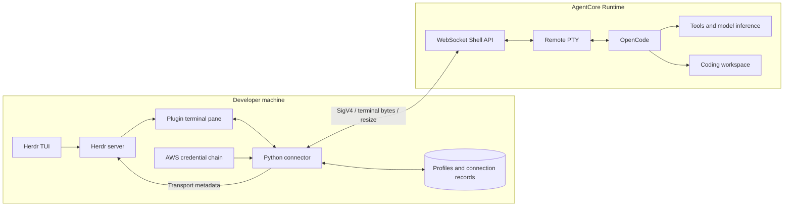
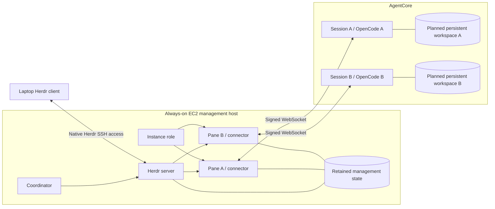
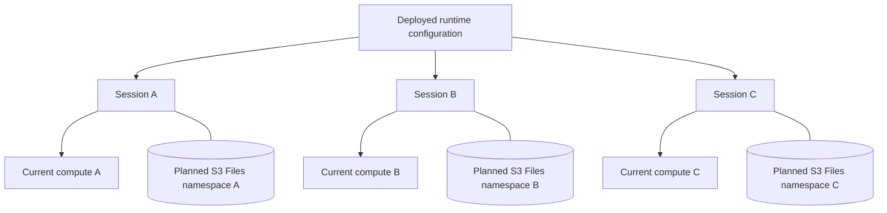
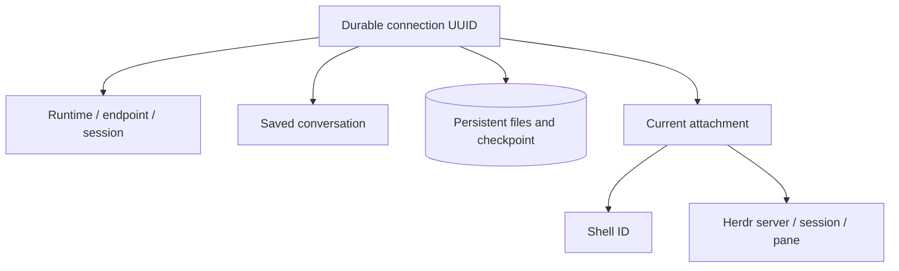
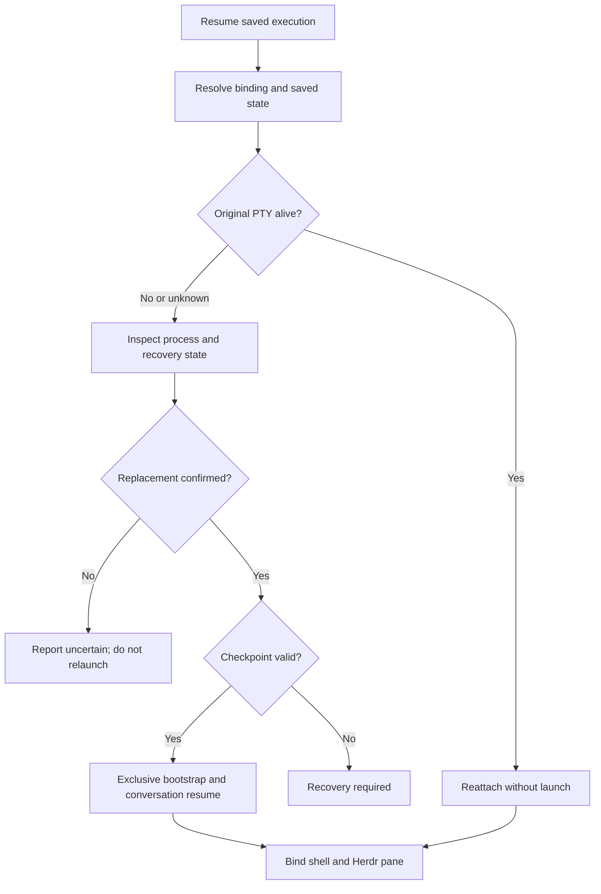
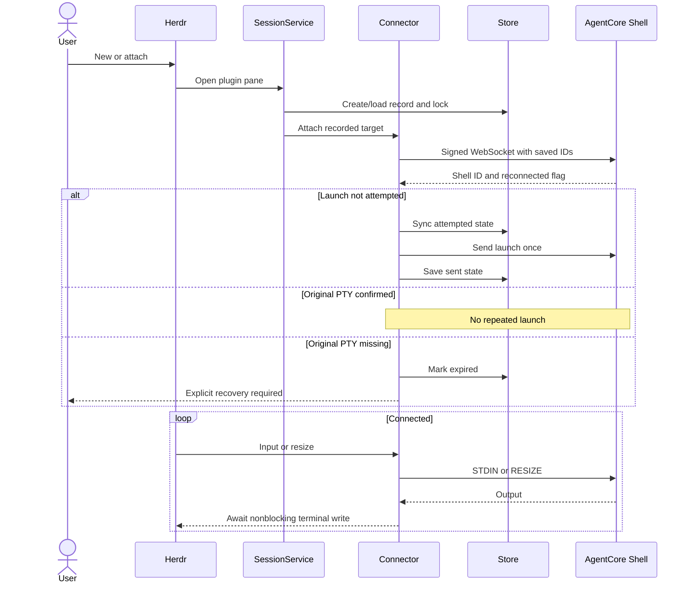
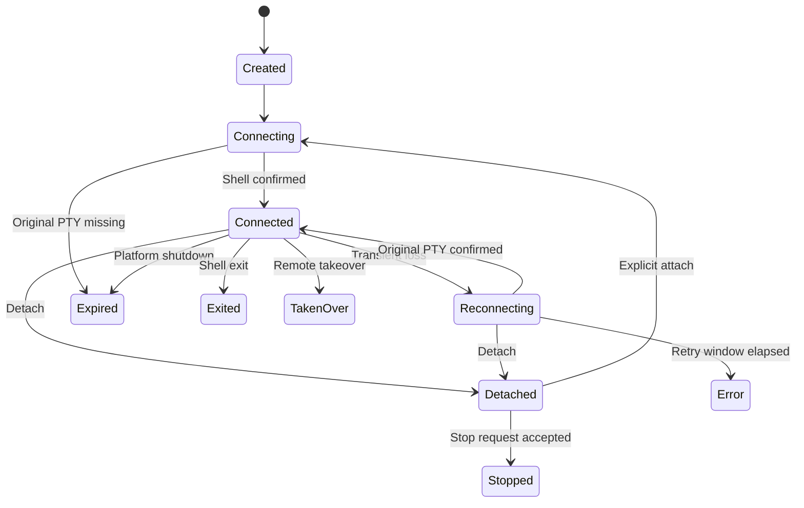

# Design

## Central decision and implementation status

**Herdr owns workspaces, tabs, panes, and live-agent identity. The plugin binds them to AgentCore execution.**
The target adds persistent coding files and recovery under the existing connection UUID.
It does not introduce a separate end-user platform.

The prototype creates agents, reattaches original PTYs, detaches, and requests compute stop.
Sections marked **target** describe planned behavior.
The current connector refuses to relaunch work when a previously used PTY is missing.
The latest verification date is 2026-10-20. See [packaging and validation](#packaging-and-validation) for current deployment and test results.
After an authorized teardown retaining the network, the reviewed runtime/storage stacks were redeployed and passed E2E checks; see the [current deployment status](../README.md#status-and-limits).
The filesystem profile already mounts shared coding files. Persistent home, conversation checkpoints, and automatic recovery remain targets.

The repository separates runtime definitions, the Herdr connector, and their connection contract.
The runtime component owns example images and official CDK definitions selected through named settings profiles.
The connector accepts deployed ARNs or exported descriptors, including external runtimes.
Opening a pane uses an existing deployment; it does not build infrastructure for each agent.

### Scope of the Jindouyun comparison

Jindouyun is a reference for persistent files, remote Working Directories, multiple shells, skills, and recovery.
It is not a required backend.
Exclude Cognito, per-user account ownership, customer runtime catalogs, DynamoDB registries, and the proposed `agentcore-code` CLI.

| Layer | Responsibility |
| --- | --- |
| Herdr | Layout, live names, terminal presentation, and public prompt/read/wait/key APIs. |
| Plugin | Runtime selection, execution bindings, shell transport, and lifecycle actions. Persistent paths and recovery remain targets. |
| AgentCore | Isolated compute, worker/tool execution, and configured storage. |
| Runtime image | Startup and model access for the selected settings. Work tracking depends on that example's implementation. |
| AWS IAM and host access | Authorize connector and worker operations. Keep human host access separate. |

One runtime session and one shell per independent agent is the default isolation policy.
Additional helper or agent shells in a session remain planned.

The hosting target is one always-on EC2 manager with Herdr, connectors, and coordination.
OpenCode workers run in AgentCore. The laptop provides access and viewing.
The repository has not deployed or validated this EC2 hosting path.

## Architecture

The diagrams use OpenCode as an example. Named runtime settings can select other assistants without changing the connector.

A Herdr server-owned pane runs its connector on the server's host.
The connector uses an authenticated WebSocket to an AgentCore remote PTY.
“Host-local” refers to the management host, which can be a development laptop or a cloud host.

### Laptop-hosted development mode



One deployed runtime can serve many sessions.
Each new independent agent gets a separate runtime-session ID and shell ID.

### Cloud-hosted management — recommended target



This diagram shows native Herdr SSH access.
Alternatively, a standard SSM shell can run the Herdr TUI on EC2, attached to the supervised server.
Standard SSM needs no SSH keys or inbound SSH port.
SSH-over-SSM still needs SSH authentication.
See the [hosting proposal](SESSION_MANAGEMENT_PROPOSAL.md#11-full-cloud-placement-and-responsibility).

The viewer connection and AgentCore sockets have independent owners.
A viewer disconnect must leave the EC2 manager and connectors running.
Coordination can continue only if it also runs in AWS.

Install Herdr, the plugin, dependencies, and profiles on EC2.
Native remote access does not copy them from a laptop.
For the SSH option, this command registers an existing SSH host alias:

```bash
herdr machine add cloudbox
```

This is a setup example, not a deployed resource.
Route laptop-side commands with the appropriate `herdr --machine <saved-profile>`.
Agent and pane IDs belong to the selected server.

### EC2 versus ECS

| Concern | EC2: first target | ECS: later alternative |
| --- | --- | --- |
| Access | Standard SSM to an EC2-side TUI, or native Herdr SSH access. | Supply compatible remote access. ECS Exec is not Herdr's SSH protocol. |
| Management | Supervise Herdr with a service manager such as systemd. | Service replacement starts a new task but loses old processes and sockets. |
| State | Retain EBS-backed files with backup and reattachment rules. | Use external persistent storage with validated locking behavior. |
| AWS identity | Instance role through the SDK chain. | Task role through the SDK chain. |
| Recovery | Reconcile after host/server restart. | Reconcile after task replacement. |

Begin with one active manager.
Add controller leases and idempotent workflow recovery before failover or multiple managers.
A local process lock does not coordinate separate hosts.

### Management-host state and credentials

Retain Herdr configuration/layout state, plugin profiles, execution bindings, and coordinator progress.
Keep installations replaceable. Keep IPC sockets and PID files on local runtime storage.
Define how a replacement host locates retained files; an existing volume alone is not a recovery procedure.

The connector uses the EC2 instance role. OpenCode uses the AgentCore execution role.
Human SSO/SSM access is a third boundary.
The existing Boto3 provider and SigV4 WebSocket path need no protocol rewrite for EC2.
Use `aws_profile: null`, reachable IMDSv2, and a service environment without conflicting static credentials.
Do not forward laptop credentials or export a one-time credential snapshot.

Run the server under the intended service account and session configuration.
A service restart restores availability, not lost connectors or workflow progress.
Automatic reconciliation remains planned.

### Failure boundaries and expected behavior

| Event | Expected behavior |
| --- | --- |
| Viewer closes or laptop sleeps | Keep healthy cloud management and workers running. Do not send stop because viewing ended. |
| Development laptop sleeps | Local connectors and coordination pause. Remote work remains subject to runtime limits. |
| Management host/task restarts | Load retained records and inspect remote work before attachment or replacement. Reconciliation is planned. |
| Shell disappears | Use strict attach or explicit process recovery based on confirmed state. |
| Compute stops | Restore persistent files and conversation on fresh compute. This recovery is planned. |
| Coordinator fails | Restore its own progress and reconcile uncertain outcomes. Server supervision cannot do this alone. |

Management recovery and worker recovery are separate mechanisms. Test both independently and together.
Remote resources can continue to incur costs without a viewer.

### Runtime fleet and session allocation

The fleet consists of sessions created from a runtime configuration.
Use separate profiles for different images, permissions, networks, or storage settings.
Do not deploy a runtime for each pane.



The planned namespaces separate independent work on a configured filesystem.
They do not require per-user access points or a separate registry service.
They are directory organization, not independent IAM security boundaries.
Permit deliberate use of an existing Working Directory without overwriting its files.

## Component responsibilities

```text
src/
  agentcore_runtime/   AWS CDK project and named runtime settings
  herdr_plugin/        herdr-agentcore package
  runtime_contract/   agentcore-contract package
```

Each component has its own README, implementation, and tests. The infrastructure project uses npm/CDK; the connector and Python contract use uv.
Both applications depend on the contract. Neither imports the other application's implementation.
The contract uses only the standard library and has no AWS, Docker, Herdr, or filesystem side effects.

| Component | Responsibility |
| --- | --- |
| `herdr-plugin.toml` | Declare build, action, and pane commands. |
| Connector `cli.py` | Parse commands, import descriptors, display menus, and request stop confirmation. |
| `models.py` | Validate profiles, typed records, launch states, and status labels. |
| `storage.py` | Read/write version-1 JSON, sync atomic replacements, isolate damaged records, and enforce locks. |
| `sessions.py` | Coordinate create, attach, selection, and stop use cases. |
| `agentcore.py` | Resolve credentials, sign handshakes, call stop, and classify AWS/WebSocket errors. |
| `connector.py` | Interpret shell frames, launch once, reconnect, and handle termination. |
| `terminal.py` | Manage raw mode, nonblocking output, bounded input, detach, and resize. |
| `herdr.py` | Call public Herdr APIs and report transport metadata. |
| Runtime `cdk/app.ts` and `cdk/profile.ts` | Select and read a provision profile. |
| Runtime `cdk/runtime-stack.ts` | Define official CDK runtime, IAM, image assets, network/storage bindings, and outputs. |
| Runtime `provision_profiles/` | Supply the Codex, OpenCode, and OpenCode/S3 filesystem deployment examples; names are not enums. |
| Runtime `agent_images/common/` | Share image build, startup, environment inheritance, mount readiness, health, and license. |
| Runtime `agent_images/opencode/` | Supply the OpenCode adapter, configuration, dependency warmup, and work-event plugin. |
| Runtime `agent_images/codex/` | Supply the Codex adapter, native AWS provider, and build-installed permission preset. |
| Contract `connection.py` | Validate and encode connection data without operational side effects. |
| `src/*/tests/` | Hold each component's offline tests and applicable live probes. |

Connector modules are under `src/herdr_plugin/herdr_agentcore/`.
Runtime infrastructure uses `src/agentcore_runtime/cdk/`. Image sources use `agent_images/`; deployment inputs use `provision_profiles/`.
Contract modules are under `src/runtime_contract/agentcore_contract/`.
Profile formats are not publicly released. Internal version fields do not imply a backward-compatibility promise.
Infrastructure has no custom provisioning executable or Python distribution. Use the official CDK CLI.
Storage offers typed records and mapping helpers.

### Connection contract

The runtime publisher exports descriptor version 1 with transport `agentcore-shell-v1`.
It contains ARN, region, endpoint, required argv, an optional `runtime_profile` settings reference, and an optional `agent_kind` recognition hint.
The connector validates and imports that data, then adds local AWS credential selection.
Credentials and host AWS credential-profile names do not belong in the descriptor.
Runtime profile names do belong in the descriptor as references to the settings used to deploy it.
For example, a profile named `reviewer` can supply an OpenCode image and hint. No connector branch is needed for that name.
See the [contract README](../src/runtime_contract/README.md) for the complete shape.

Direct ARN registration can set the same fields explicitly.
All profiles with no hint use an ordinary terminal. The connector never infers OpenCode or a launch command.
Herdr must support an agent kind before its recognition hint can enable agent APIs.
An API-only runtime does not become a terminal assistant merely because its ARN is valid.
The contract does not yet define persistent checkpoints or resume operations.
Image definitions declare `/app/run.sh`. A provision profile can override the declared command.
The override changes descriptor argv, not the image's container `CMD`. The selected executable must exist in the runtime.
See the [existing-runtime guide](CONNECT_EXISTING_RUNTIME.md) for registration and verification.

## Repository-owned runtime and provisioning

Standard `cdk deploy` deploys the named runtime settings independently of the connector.
The supplied OpenCode and Codex images adapt `awslabs/agentcore-samples`.
The repository keeps one Apache-2.0 `LICENSE` and one `NOTICE` at its root.
Python package builds bundle those files in their distributions. Docker builds copy them into `/app`.
No research checkout, GitHub gateway, or shared sample deployment file is required.

### Deployment sequence

1. Select the repo's `provision_profiles/NAME.json` with CDK context `runtimeProfile=NAME`. Resolve its env references from `src/agentcore_runtime/.env`; the adjacent `.sample.env` defines the local bindings to fill.
2. Confirm the AWS identity, target region, and CDK bootstrap environment.
3. Run `cdk synth` to validate the application and generate its template/asset manifest.
4. Run `cdk diff` and review IAM, image, runtime, and output changes.
5. Run `cdk deploy`. CDK builds and publishes the ARM64 Docker asset through the bootstrap repository.
6. CloudFormation creates or updates the execution role, policies, and native `AWS::BedrockAgentCore::Runtime` resource.
7. CDK writes resolved outputs to the ignored `.local/deployments/` outputs path after success.
8. Import the selected stack's `ConnectionDescriptor` with the connector.

The current settings name `HerdrOpenCodeRuntime`, `HerdrOpenCodeS3FilesystemRuntime`, and `HerdrCodexRuntime`.
These are example profile properties, not connector constants.
Role trust restricts access to the account and matching runtime name. CDK's repository grant supplies image-pull access.
Normal startup selection requires only `inference.modelId`. OpenCode uses the selected model's native catalog metadata; the Codex image defaults to the Runtime provider.
The optional advanced override `inference.bedrock-endpoint-type` accepts exactly `"runtime"` or `"mantle"`. The samples omit it.
Each sample execution role permits both Runtime and Mantle inference. Startup routing no longer narrows those permissions.
These are project-defined configuration values, not built-in CDK enum values.
The same generic stack consumes each settings file. It exports `BEDROCK_ENDPOINT_TYPE` only when the profile explicitly supplies the override.
The entrypoint resolves `.env`, the provision profile, and the image definition before constructing the stack.
The stack receives resolved properties. It does not read environment variables or configuration files.
`runtimeProfile` is the project selection context. Per-field context overrides are rejected; exported shell variables do not replace `.env` bindings.
Deployment region comes from the profile. Account identity comes from the authenticated CDK Toolkit and must be resolved before synthesis.

The official libraries are `aws-cdk-lib`, `constructs`, and the `aws-cdk` CLI.
The project uses TypeScript, Node.js 22+, npm, and Docker with ARM64 support.
The existing CDK bootstrap provides deployment roles and asset storage. It is shared infrastructure, not part of the runtime's teardown.

Runtime model authorization is separate from deployment authorization. Verify model availability and account access.
Profiles select lifecycle values and optional storage. Codex and plain OpenCode use PUBLIC mode; the filesystem sample uses a storage-only stack and creates its own S3 Files access point.
Bucket, external network IDs, and access-point root settings come from the component `.env`. The storage stack name comes from `s3Files.storageStackName`.
The current implementation creates no VPC, subnets, security groups, routes, gateways, or bucket. It consumes existing network identifiers.
Each filesystem worker receives access-point-scoped mount/write access and required metadata reads. Its role has no direct-S3 grants or bucket lookup.
On 2026-10-20, adoption preserved all 23 existing infrastructure resource identities and properties. The S3 runtime/DEFAULT reached version 5; other runtimes stayed at version 4.
The user selected an empty dedicated root. Fresh-session checks passed mount access, no inherited MCP configuration, and a non-root cross-session file write/read with cleanup.
All samples declare a 900-second idle timeout and 28,800-second maximum lifetime in their profiles.
Deployment does not create an assistant session. The new-agent action does that.

### Runtime bootstrap and authentication

The image defaults to OpenCode 1.18.30 and checks its installed version during build.
Its HTTP service runs as an unprivileged user.
All supplied profiles use `agent_images/common/Dockerfile` with explicit npm package/version, executable, and adapter directory arguments.
The build context is the repository root. CDK includes root legal files, shared image files, and the selected adapter only.
Another adapter's changes do not invalidate this image asset. Deployment bindings and other components are excluded.
The shared `/app/run.sh` executes `/app/run.py`, copied from the selected image's directory.
It selects the image-installed Python through an absolute path.
The common launcher repairs tool discovery and prepares local package caches, tool environments, and build directories.
The image provides a checksum-pinned coding toolchain. See the [tool inventory](../src/agentcore_runtime/README.md#coding-tools-and-mcp-environments).
The generic `agentcore-mcp` command rebuilds locked Python dependencies from an explicit persistent tool project into a local environment.
It registers no particular MCP server. Per-binding storage allocation and conversation recovery remain separate requirements.
That entrypoint imports `runtime.py` helpers for environment inheritance, mount checks, working-directory selection, and native process execution.
The OpenCode adapter forwards native argv, including `--session`. The common launcher selects `AGENTCORE_WORKDIR` or the image home.
It preserves user configuration and does not grant automatic tool approval.

The OpenCode adapter sets `OPENCODE_DISABLE_AUTOUPDATE=1` for launch and build-time dependency warmup.
OpenCode's updater reads global configuration; the extra config's `autoupdate: false` alone did not suppress its dialog.

`OPENCODE_CONFIG=/app/opencode.json` supplies the Bedrock provider, region, and model.
Without an endpoint override, the adapter preserves native catalog routing and does not create `OPENCODE_CONFIG_CONTENT`.
With an explicit override, it adds the startup model's SDK selection to that process-local JSON setting and retains other settings.
Native catalog routes apply to later model choices. The image's custom Kimi entry includes its Runtime SDK metadata.
`AWS_PROFILE=default` selects OpenCode's refreshable Node provider chain inside AgentCore.
Without injected keys or credential files, the chain resolves the execution role.
The launcher does not fetch IMDS credentials, export keys, or save tokens.
It copies only allowlisted non-secret deployment settings from PID 1 when the shell lacks them.

The image includes a local OpenCode activity plugin and health reader.
The build resolves plugin SDK dependencies so the default home can load the hook without package downloads.
The PUBLIC profiles have no S3 Files mount. Their coding files and assistant state are ephemeral.
The filesystem provision profile mounts its generated access point at `/mnt/workspace` and requires that mount before launch.
After the documented directory-marker repair, 4 KiB and 8 MiB write/read tests passed across separate sessions.
Home and conversation state still use local runtime storage. Persistent home, checkpoints, and broader cold-read/performance tests remain pending.

The Codex example pins version 0.163.0 and selects the native `amazon-bedrock-runtime` provider for GPT-5.6 Sol.
An explicit Mantle selection uses `amazon-bedrock`. Both use the native AWS credential chain and the declared inference region.
Runtime selection disables hosted web search, which is unavailable on that endpoint.
It forwards native argv without overriding approval policy or generating a one-time bearer token.
The build hook installs an initial restricted permission preset. Startup preserves existing user configuration.
Model invocation permissions do not guarantee cross-model history compatibility.
Codex 0.163.0 replays encrypted reasoning items across model changes. Controlled Runtime tests stalled when Sol reasoning was replayed to Astra, but passed with Sol or with that reasoning item omitted.
Fresh native Astra/Luna conversations passed. The project does not modify live Codex history or install a request-rewriting proxy.
OpenCode's native catalog contains both Runtime and Mantle entries. Each model entry selects its SDK and endpoint; each execution role permits both paths.
Codex has separate native providers for Runtime and Mantle. Its startup provider selects the catalog used by its model picker.
See the [model-switch diagnosis](../src/agentcore_runtime/README.md#model-switch-diagnosis--2026-10-19) for evidence and recovery limits.
Both images use the shared health reader. The Codex adapter has no work-event source, so it currently supplies readiness only.
See the [runtime comparison and status evidence](../src/agentcore_runtime/README.md#opencode-and-codex-comparison) for Herdr's separate native support and remaining validation gaps.

### Updates, failures, and cleanup

Use `cdk diff` and `cdk deploy` with the same stack, profile, account, and region.
New sessions use the new image. Existing processes do not restart or reload their environment.

Sample roles permit Bedrock model invocation on all resources so live model selection does not need a model-ID allowlist.
The role grants inference/discovery actions, not Bedrock administration. Account retention and service controls still apply.
The user authorized Runtime retention `default` in Ireland and an Ireland-only exception to the managed zero-retention guard.
The user later authorized the separate Ireland Mantle setting to become `default` as well. Both Ireland account settings now use `default`.
The managed guard's other-region rules and logging restrictions remain unchanged. Profile deployment does not change those account controls.
CDK does not read and merge arbitrary prior IAM policies. Its declared configuration is authoritative.
Review removals before updating. CloudFormation rollback does not create a transaction across every asset and local profile.
A failed deployment can leave published assets or a failed stack. Inspect standard CDK/CloudFormation events before retrying.
The connector profile changes only through explicit registration of successful outputs.

For teardown, stop the selected runtime's sessions, then use `cdk destroy` for its stack.
Keep shared CDK bootstrap resources. Their asset retention and garbage collection are separate operations.
Remove a local connection profile separately if it is no longer required.
Earlier two-stack custom-provisioner results are historical evidence, not the current deployment procedure.

## Herdr integration

The plugin declares five actions and matching pane entrypoints:

- `agentcore.setup`: configure a runtime profile.
- `agentcore.new`: start an agent with the selected/default profile.
- `agentcore.attach`: reattach a saved connection.
- `agentcore.sessions`: show last-known records.
- `agentcore.stop`: confirm whole-session stop for detached work.

Actions use `herdr plugin pane open` with the invocation context's target.
They execute on the selected Herdr server host.
The connector re-executes with the saved `agent_kind` as `HERDR_AGENT` so Herdr can recognize the host-side wrapper.
An ordinary terminal profile clears inherited hints. Existing OpenCode-only profiles retain their old behavior.

Herdr lifecycle remains screen-derived.
The connector publishes separate `cloud` and `connection` metadata tokens.
Transport connectivity and cached screen output do not establish current agent health.
The standard OpenCode-to-Herdr socket integration cannot directly reach a host socket from an AgentCore microVM.
A remote lifecycle relay remains planned.

### Herdr-native orchestration

After agent recognition, use `agent list`, `agent prompt`, `agent read`, `agent wait`, and `agent send-keys`.
`agent start --kind opencode` selects a local canonical executable; it is not an AgentCore deployment API.
A host-side script or master agent can coordinate multiple worker panes through public APIs.
Cloud workers do not automatically gain access to the manager's Herdr socket.

### Default and controller-selected runtime profiles

New-agent selection uses this order:

1. Explicit `--profile`.
2. Controller-supplied `HERDR_AGENTCORE_PROFILE`.
3. Saved `default_profile`.

`action new --profile NAME` forwards the override through Herdr's public `--env` option.
`new` and `menu new` use the same precedence.
Attach and stop use the saved target and reject an explicit profile override.

`set-default NAME` validates the profile and writes configuration under its lock.
The first profile becomes default; later saves preserve the choice.
Selection and snapshot come from one configuration read.
Changing defaults does not change saved connection targets.

Configuration formats are unreleased. There is no historical-name or single-profile fallback.
Without `default_profile`, require an override or `set-default`. Do not guess, open a picker, or fall back from invalid input.
The `profiles` command retains its output shape.

Offline precedence and snapshot tests pass.
An earlier two-profile cloud probe selected the default without input and passed model/attach/follow-up/stop checks.
That probe waits for a detached pane to close before invoking the next action.

### Additional shells and operation scope — target

```text
Herdr workspace/tab
  Implementation pane → session A / shell 1 → OpenCode conversation 1
  Test pane           → session A / shell 2 → ordinary build/test shell
  Review pane         → session B / shell 3 → OpenCode conversation 2
```

Each pane binds to one shell. Session sharing is deliberate.
Only actual agent panes receive the OpenCode hint.
Add separate detach, shell/process stop, and session stop before shared-session panes.
Whole-session stop affects all shells and must identify that scope.

## Agent identity and storage

| Identity | Meaning |
| --- | --- |
| Connection/binding UUID | Canonical saved execution identity. Reuse it for future recovery. |
| Runtime ARN + endpoint + session ID | Remote execution context. A session ID alone is not portable across deployments. |
| Shell ID | One PTY lifetime. Reuse for warm attachment; replace only during explicit recovery. |
| OpenCode conversation ID | Saved conversation to resume. Not yet captured automatically. |
| Herdr server/session + pane ID | Current attachment. Pane IDs can change and are server-scoped. |
| Herdr agent name | Live alias with uniqueness rules. It is not the durable key. |

Configuration is `HERDR_PLUGIN_CONFIG_DIR/config.json`.
Records and locks are under `HERDR_PLUGIN_STATE_DIR`.
These locations belong to the management host, not necessarily the viewing laptop.
Standalone CLI use also supports XDG defaults and directory overrides.

Version-1 records contain a profile snapshot, remote IDs, launch state, status, and timestamps.
`ConnectionRecord` validates required fields, enums, UUIDs, and timezone-aware timestamps at the storage boundary.
Unknown recovery annotations survive round trips.
Lists warn about damaged records and continue with healthy records; explicit loading still fails.
Records sort by creation instant, including timezone offsets.

Writes sync the temporary file, replace the destination atomically, then sync the parent directory.
Attachment and stop use a local per-connection lock.
The lock file remains in place so another process cannot acquire a different inode for the same connection.

### Target execution-binding records

Migrate the record to include persistent paths, conversation ID, checkpoint/version metadata, desired name, and current attachment.
Keep the host-local store initially. Do not add a customer registry service.



Restore a desired name only after the recovered agent is recognized.
Report occupied or ambiguous names instead of replacing unrelated agents.
Short metadata prefixes are for display/discovery; resolve a unique full UUID before operations.
Unknown remote IDs need an explicit adoption flow. Do not guess the shell or conversation.

## Persistent coding files through S3 Files

**Implemented:** use one dedicated access point per S3-backed profile, rooted at `/agent-filesystem/profiles/<profile-name>`.
Each runtime mounts and works directly at `/mnt/workspace`.
See [profile storage mapping](STORAGE_MAPPING.md) for the complete S3, access-point, runtime, and permission mapping.
TypeScript CDK manages S3 Files storage using an external network and bucket. Each S3-backed provision profile creates a dedicated access point.
The launcher does not create another profile directory inside the mount. Configuration, skills, and tools belong directly in that profile's mounted root.
Worker IAM is scoped to its generated access point. The provision-profile schema rejects externally supplied access points and cross-profile access-point sharing.
New roots start empty; no data migration is implicit. The legacy sample access point is not recreated.
Bucket and existing subnet/security-group IDs come from the component `.env`.
Access-point UID/GID `1000:1000` and directory mode `755` are fixed CDK values matching the runtime images.
Storage identifiers flow through CloudFormation references; network identifiers are external bindings. The filesystem uses the bucket root without a prefix.
Earlier cross-session file tests passed for 4 KiB and 8 MiB files. The PUBLIC profiles have no shared mount.
**Target:** add per-binding namespaces, persistent configuration/skills, conversation checkpoints, and recovery.
Mount/root are deployment settings, not per-user identity resources.
Example service configuration shape:

```json
{
  "filesystemConfigurations": [
    {
      "s3FilesAccessPoint": {
        "accessPointArn": "<cdk-generated-profile-access-point-arn>",
        "mountPath": "/mnt/workspace"
      }
    }
  ]
}
```

Proposed layout:

```text
/mnt/workspace/                     This profile's access-point root
  mcp/                              Profile-local tools, if configured
  herdr/<binding-uuid>/
    repo/                           Files, .git, and uncommitted changes
    config/                         Non-secret tool configuration
    skills/                         Configured worker skills
    artifacts/                      Selected results
    checkpoints/                    Consistent application backups
    recovery.json                   Identity and recovery metadata
```

Configure persistent `HOME` or supported data directories without hiding installed executables.
Record the remote Working Directory separately from the management-host pane directory.
Reuse saved paths after attachment or replacement.
Give independent writers separate worktrees and conversation state by default.
Validate skill discovery; placing files in a directory alone does not configure it.

### Bootstrap and filesystem behavior

- Check the mount before launch. Do not silently fall back to ephemeral storage.
- Initialize defaults once. Preserve existing files and configuration on later launches.
- Replace the external sample's forced home/directory and config rewrite when integrating persistence.
- Validate Git, package managers, rename/flush, locking, crash recovery, and concurrent access.
- Keep live SQLite state on local disk initially. Publish consistent backups to S3 Files.
- Do not copy only a live `.db` file or assume SQLite WAL works on a network filesystem.
- Keep PIDs, sockets, health leases, and disposable caches local and ephemeral.
- Validate conversation/checkpoint compatibility before process replacement.
- Coordinate bootstrap and recovery so they cannot create duplicate writers.

S3 Files needs VPC connectivity, mount targets, execution-role permissions, and correct access-point UID/GID.
Directory namespaces are not IAM isolation boundaries.
Define backups, retention, and migrations. Detach, stop, and uninstall must not delete persistent work.

Managed session storage Preview is a later option with different semantics.
The reviewed documentation describes reset after 14 days without invocation and after runtime-version changes.
AgentCore Instances with capacity-provider EBS are another compute choice; they are not the current microVM deployment.
See the [checkpoint proposal](SESSION_MANAGEMENT_PROPOSAL.md#6-opencode-database-and-checkpoint-strategy).

Profile-root startup is implemented. The filesystem sample mounts and starts at `/mnt/workspace`.
The `/mnt/workspace/herdr/<binding-uuid>` layout above is a proposal, not the deployed layout.
Persistent home, per-binding repository selection, automatic conversation capture, and that storage layout remain unimplemented.

## Resume semantics — target

| Situation | Required action | Preserved identity |
| --- | --- | --- |
| Original PTY/process survives | Reattach without launch. | Binding, session, shell, conversation. |
| Compute survives; original PTY unavailable | Inspect the process/supervisor. Attach surviving work or confirm exit before explicit resume. | Binding, session, paths, conversation; shell may change. |
| Compute stopped | Reuse session ID, remount storage, validate state, and resume in a new shell. | Binding, session, files, conversation. |
| Storage missing/incompatible | Report recovery required. Require explicit repair or migration. | Binding and failure evidence. |

Recovery is explicit, not an automatic reconnect retry.
It restores files and saved conversation state, not memory, running tools, or an instruction pointer.
A socket failure does not prove that a writer stopped.
A supervisor or named `tmux` session may decouple work from one PTY while compute survives; neither is installed by this plugin.



### User-facing lifecycle operations

| Operation | Contract | Status |
| --- | --- | --- |
| New | Allocate independent binding/session; initialize or explicitly select files. | IDs, launch, and profile-selected mount/cwd are implemented. Automatic per-binding storage remains pending. |
| Attach | Reattach original live PTY. | Implemented. |
| Detach | Disconnect transport without stop. | Implemented. |
| Stop runtime session | Stop all session compute/processes; keep records and persistent files. | API request implemented. No completion waiter or resume. |
| Stop shell/process | Stop selected execution without affecting siblings. | Planned. |
| Resume | Choose warm attachment or confirmed checkpoint recovery. | Planned. |
| Archive | Mark work finished and retain/export results. | Planned. Data deletion is separate. |

The WebSocket adapter retries classified transient errors, including explicit `RetryableConflictException`.
Unknown HTTP 409 responses remain terminal. Retry never changes session identity or replays work.
Bounded provisioning/stop conflict handling and stop-completion detection remain recovery work.

### Independent state dimensions

| Dimension | Examples | Authority |
| --- | --- | --- |
| Compute | running, stopped, recovering, unknown | AgentCore and future supervision. Local records are observations. |
| Connection | attached, detached, reconnecting | Connector. |
| Agent work | working, idle, waiting, unknown | Herdr screen detection; separate OpenCode-derived AgentCore health. |

The version-1 `stopped` label means the API accepted a stop request, not confirmed completion.
Idle is not stopped compute. Detach is not task completion.
The health bridge does not relay lifecycle events to Herdr or supervise recovery.

## Current launch and reattach sequence



The OpenCode definition supplies `["/app/run.sh"]` unless its caller overrides it.
The generic contract and connector require explicit argv and provide no default.
The connector quotes each argument and sends `exec env TERM=xterm-256color COLORTERM=truecolor ...`.
Persisting `attempted` is mandatory before sending the launch.
If delivery is uncertain, show the existing terminal rather than send another command.

### Historical sample credential adaptation

An earlier prototype used a shim for external sample images that exported static credentials.
The current example launchers use native role providers directly. The old custom runtime CLI has been removed.
External image owners can supply a reviewed wrapper through explicit argv when required.
The connector does not implement or choose runtime authentication.

That wrapper resolved the real executable, created a private temporary shim, and prepended it to `PATH`.
It then ran the original launcher.
When the launcher invoked OpenCode, the shim removed four static credential variables and set `AWS_PROFILE=default`.
It executed the original binary with unchanged arguments.

The removed variables are `AWS_ACCESS_KEY_ID`, `AWS_SECRET_ACCESS_KEY`, `AWS_SESSION_TOKEN`, and `AWS_SECURITY_TOKEN`.
Removal must occur after initialization because the sample launcher exports a fresh snapshot during startup.
The shim preserves generated region/model/MCP configuration.
Host `aws_profile` remains independent from runtime `AWS_PROFILE`.

Validate original argv before wrapping and validate the wrapped result.
Absolute OpenCode paths bypass the shim. Explicit provider credentials, files, or API keys can select a different identity.
Enable it only where the default chain resolves the intended role.
The temporary shim is ephemeral; automatic process repair and full-lifetime rollover tests remain separate work.

## Current connector transport and lifecycle behavior



- Resolve/refresh credentials outside the event loop, then sign each handshake.
- Use the SDK signing helper with direct framing so confirmation remains visible.
- Forward output bytes without decoding. Bound WebSocket buffers and input chunks.
- Await nonblocking partial writes. A full PTY buffer must leave timers, resize, and detach responsive.
- Remove write callbacks on cancellation. Restore modes with `TCSANOW`, without waiting for output drainage.
- Forward dimensions initially, after resize, and after reconnect.
- Pause and discard input during outages. End the connector after ambiguous input delivery.
- Classify errors from safe codes/status, not raw bodies or signed URLs.
- Retry HTTP 429, server failures, and known transient codes within the configured reconnect window.
- Reject competing local attachments with the lock. Do not reconnect after remote takeover.
- Ctrl+] then `d` detaches. Ctrl+] twice sends a literal prefix.
- Stop requires confirmation and the lock. It targets all compute in that runtime session.

### Deployed session lifecycle

The latest control-plane checks confirmed `idleRuntimeSessionTimeout: 900` and `maxLifetime: 28800` for all three profiles.
These values come from each provision profile's `lifecycle` settings and are applied by `cdk/runtime-stack.ts`.
The PUBLIC profiles have no filesystem configuration. The filesystem profile has one S3 Files mount.

| Limit or operation | Meaning |
| --- | --- |
| Idle | Platform-determined inactivity can stop compute after 15 minutes. Invocation activity and `HealthyBusy` affect accounting. |
| Maximum | Compute ends after 8 hours. Activity, reattachment, and credential refresh do not reset the clock. |
| Threshold timing | The reviewed AWS documentation allows up to 15 seconds for termination after a threshold. |
| Scope | Each session has its own compute/timers. Termination does not delete the deployment, role, image, or local record. |
| Detach | Close transport without requesting termination. |
| Stop | Request whole-session termination. No completion waiter exists. |
| Data | PUBLIC-profile coding files and all default assistant home/conversation state are ephemeral. The filesystem profile's mounted coding files persist separately. Saved IDs alone cannot reconstruct a conversation. |

Full-duration platform expiry tests remain pending.
The exact effect of interactive Shell traffic on idle accounting has not been validated here.

### Activity-aware health — deployed and validated

The earlier deployed bridge used session events and per-session question/permission waits.
It passed cloud tests for work, a question/reply cycle, completion, and process death.
That concurrency-aware bridge is part of the current OpenCode image. Earlier cloud activity probes passed, and the latest local image test passed real work and process-death transitions.
The latest six-session cloud check tested model/tool calls and folder access; it did not repeat the question/wait health probe.
Concurrent and nested-tool wait cases have offline event-test coverage; live permission-dialog coverage remains pending.

The current `activity-plugin.mjs` uses public OpenCode 1.18.30 `event`, `dispose`, `tool.execute.before`, and `tool.execute.after` hooks.
The tracker also reads tool-part events so errors can clear work even without an after hook.
It keeps session status, active tool-call IDs, and wait-request IDs in memory.

Rules:

- Session `busy` and `retry` indicate work until completion or an input wait.
- A scoped wait blocks its associated tool, not every tool in the session.
- Other active tools and sessions keep health busy.
- Task metadata can link a parent call to a child session. A known child wait propagates through that task.
- A parent with other active tools remains busy. A background child can remain busy after its parent becomes idle.
- Unknown child activity or a malformed cycle remains conservatively busy.
- Unscoped waits suppress an unambiguous sole tool or a question tool. Ambiguous parallel work remains conservative.
- A model error does not prove concurrent tools stopped. Tool completion/error events and session idle clear their state.

Each plugin instance writes a private atomic lease under `/tmp/herdr-agentcore-activity` only while busy.
The lease contains version, PID, Linux start tick, timestamp, and busy flag.
It contains no session graph, prompt, tool argument, credential, or conversation text.
Busy heartbeats run every 10 seconds. Idle and disposal remove the lease and timer.

The shared `common/activity.py` accepts leases no older than 45 seconds with a matching live PID/start tick.
It rejects stopped, zombie, exited, reused-PID, malformed, oversized, symlink, and future-dated records.
No valid lease means `Healthy`; valid work means `HealthyBusy`.
Internal lease timestamps never become a continuously advancing AWS `time_of_last_update`.

Sixteen minutes of work followed by an unanswered question can start the idle window at minute 16.
With no other tracked work, the 15-minute threshold is around minute 31.
The 8-hour maximum remains unchanged.

The bridge does not track arbitrary detached OS jobs.
`--pure` or replacement configuration can disable external hooks.
It is neither persistent storage nor a recovery supervisor.
Publish an image update and start fresh processes to deploy a changed hook.

## Implementation increments

1. Extend dialog, forced-network-outage, and pane-layout coverage.
2. Migrate bindings to persistent paths, conversation IDs, and checkpoint/version metadata.
3. Integrate S3 Files, safe checkpoints, and runtime-side recovery supervision.
4. Deploy one supervised EC2 manager with retained state, instance-role access, and validated SSM/SSH access.
5. Add explicit resume, Herdr rebinding, host reconciliation, and bounded stop/provisioning conflict handling.
6. Add helper/agent shells with separate shell and whole-session stop scope.
7. Test replacement, expiry, competing recovery, and uncertain tool outcomes before failover or ECS hosting.

These increments require no Cognito or Jindouyun platform dependency.

## Packaging and validation

### Latest verification — 2026-10-20

The final pinned coding-tool images and generic MCP bootstrap reached Runtime/DEFAULT version 4 and READY on all three profiles.
The updates changed only container images. Both ARM64 builds, 230 Python tests, and 22 CDK tests passed.
Cloud tests passed native builds, user-local CLI installation, MCP initialization/discovery/calls, and model-driven OpenCode MCP calls.
A second S3-backed runtime rebuilt the disposable MCP from unchanged persistent definitions.
Codex sandbox/model checks and both OpenCode activity probes passed. All disposable sessions received stop requests, and probe S3 files were removed.
See the [coding-tool deployment results](../src/agentcore_runtime/README.md#coding-tools-and-generic-mcp-deployment--2026-10-20).

### Launcher verification — 2026-10-19

The launcher and root-legal-file image update reached Runtime/DEFAULT version 2 and READY on all three stacks, with unchanged ARNs.
Cloud source-hash checks verified `run.sh`, the selected `run.py`, shared helpers, and copies of the two root legal files. Obsolete entrypoints were absent.
All three isolated interactive flows passed, including attachment, context follow-up, role checks, shell time, and stop.
Codex sandbox, both OpenCode health flows, fresh Runtime/Mantle calls on both OpenCode profiles, and cross-session S3 file tests passed.
The first PUBLIC OpenCode question wait timed out at 30 seconds; a fresh retry passed. All disposable test resources were cleaned up and final CDK diffs showed no changes.
See the [launcher deployment results](../src/agentcore_runtime/README.md#launcher-deployment-and-e2e--2026-10-19). Native cross-model history limits remain.

The model-only revision rebuilt both images and passed TypeScript, 21 CDK tests, and 217 Python tests.
Six existing sessions received stop requests. The three numbered stacks, runtimes, and roles were deleted, then recreated through official CDK.
All new Runtime/DEFAULT endpoints reached version 1 and READY. Deployed environment variables contain no endpoint override.
All three interactive model/role/attachment/follow-up/shell-time/stop probes passed. Both OpenCode question/activity probes and Codex sandbox checks passed.
Cross-session 4 KiB/8 MiB file verification passed. Both OpenCode profiles called Runtime and Mantle models in fresh conversations without an endpoint setting.
Same-conversation Kimi-to-Astra recall passed. Continuing that history with Mantle GPT-OSS failed Responses input validation; native history compatibility remains a limit.
Six replacement interactive sessions were left connected in three tabs. Disposable probes and isolated servers were cleaned up, and final CDK diffs showed no changes.
See the [model-only rebuild results](../src/agentcore_runtime/README.md#model-only-profile-rebuild--2026-10-19).

Before the rebuild, the dual-endpoint update changed only the inference policies for all three execution roles. Each stack reached UPDATE_COMPLETE; runtime versions remained 4, 1, and 1 and all endpoints were READY.
A separate agent changed Ireland Mantle account retention to `default`; Runtime stayed `default`, and the managed guard policy did not change.
Both OpenCode profiles passed native Global Astra calls through Runtime and GPT-OSS 20B calls through Mantle. The Mantle Astra entry instead returned model-not-found 404 in Ireland.
Codex Global Astra calls passed, but no successful Codex Mantle turn is claimed for this check. All disposable probe sessions received stop requests.
TypeScript and 21 CDK tests passed. See the [dual-endpoint verification](../src/agentcore_runtime/README.md#dual-endpoint-permissions-and-ireland-retention--2026-10-19) for scope.

A later all-profile verification rebuilt both ARM64 images and passed 21 CDK tests and all 212 Python tests.
CDK deploy completed for all three numbered profiles with no changes. Runtime/DEFAULT versions remain 4 for Codex and 1 for both OpenCode profiles; all are READY.
Two user-requested interactive sessions per profile passed real date and read-only folder-access checks in three Herdr tabs.
A separate storage probe verified matching 4 KiB and 8 MiB file contents across sessions and removed its test files.
Its three disposable sessions received stop requests. The six user-requested sessions remained connected.
Final CDK diffs showed no changes. See the [all-profile results](../src/agentcore_runtime/README.md#all-profiles-and-six-interactive-sessions--2026-10-19).

The latest Codex revision uses GPT-5.6 Sol through native Bedrock Runtime in Ireland.
The image, model, endpoint environment, and inference IAM update replaced the GPT-OSS/Mantle revision.
CloudFormation reached `UPDATE_COMPLETE`; Runtime/DEFAULT version 4 is `READY`. The final CDK diff showed no changes.
Ireland Runtime retention read back as `default` before and after deployment. This deployment did not change account controls.
Fresh sessions passed real Sol inference, native sandbox isolation, a model-driven `date` call, and runtime-role credential checks.
An isolated Herdr probe passed default selection, recognition, detach/attachment, context-preserving follow-up, and an interactive `date` call.
Both probe sessions received stop requests, and the isolated server stopped.
The ARM64 build, TypeScript check, 21 CDK tests, and 203 Python tests passed; nine other opt-in Python checks were skipped.
See the [dated Runtime results](../src/agentcore_runtime/README.md#sol-on-native-bedrock-runtime--2026-10-19) for scope and remaining limits.

### Historical profile and image validation

The following results describe earlier revisions. Their runtime versions, retention modes, and pending checks are not the current deployment state.

The earlier model/storage revision selected GLM 5.3 for Codex and retained Bedrock Runtime in Ireland.
Runtime/DEFAULT version 2 reached READY. Real inference, sandbox checks, and a model-driven `date` call passed under retention mode `none`.
The storage repair used AWS's documented POSIX metadata on the missing S3 directory marker, matching the sample's non-root UID/GID 1000 design.
The unchanged filesystem runtime passed 4 KiB and 8 MiB write/read checks across separate sessions. No new storage layer or broader runtime permissions were introduced.
Tests passed 21 CDK cases and 212 Python cases; final Codex and filesystem CDK diffs showed no changes.

The numbered-profile revision passed 21 CDK tests and 212 Python tests, then deployed all three stacks in `eu-west-1`.
All Runtime/DEFAULT endpoints reached version 1 and READY. Both OpenCode model calls passed; Codex/Sol was blocked by the unchanged `none` retention setting.
The access-point-only sample mounted successfully, but directory creation failed: the mounted root was 0:0 with mode 0755 and the agent was 1000:1000.
That initial run did not qualify writable storage. The later directory-marker repair and cross-session tests resolved this gap.
All own smoke-test sessions received stop requests, and final CDK diffs showed no changes.

The configuration review passed 20 CDK tests, 212 Python tests, and synthesis of all three profiles.
Tests verify the file configuration boundary, profile-selected regions and models, stable logical IDs, and the existing IAM-policy dependency.
That filesystem template used access-point permissions without a bucket lookup or direct-S3 grants. File-I/O qualification was pending at that stage.

The endpoint-selection revision passed 16 CDK tests and 212 Python tests with both rebuilt ARM64 images.
All three samples synthesized successfully. Checks cover both endpoint values, IAM/environment agreement, and native client configuration.
These checks are local. The cloud results below apply to earlier image and model selections.

The shared-image refactor passed local checks and later cloud E2E tests on separate disposable deployments for both examples.
Both passed real model calls through Herdr, credential inspection, detach/attachment, follow-up context, and explicit stop requests.
OpenCode also passed deployed activity-health checks. Later Codex shell-tool and isolation tests passed; work-event reporting and long-duration behavior remain gaps.
Both temporary stacks and runtimes were confirmed deleted. One native CloudFormation deletion timeout required a retry after the runtime was confirmed absent.
Detailed findings and warnings are recorded in the runtime root README. The historical sections below describe prior implementations.
The refactor passed 180 Python tests with both rebuilt images, six CDK tests, and TypeScript checks.
The full assistant comparison and Herdr detection evidence are maintained only in the runtime root README.
After disposable qualification and commit, the shared images were deployed to persistent OpenCode and Codex stacks.
Both runtimes and their DEFAULT endpoints reached READY. Herdr imported both CDK output descriptors and retained OpenCode as its default.
New sessions on both persistent deployments passed the model/role/attachment/follow-up/stop probe. OpenCode's activity-health probe also passed.
Those deployments remained available after probe cleanup. They were later retired before the numbered replacements were created.
The later Codex sandbox fix reached persistent runtime and DEFAULT endpoint version 2, both READY.
Its native permission preset passed real `date` tool execution, scoped filesystem isolation, and an interactive Herdr tool call after attachment.
The runtime root README records the checks, containerd-alias cause, and remaining limits. Existing user sessions were not replaced.

### Packaging and repeatable checks

Herdr supports installation from a public GitHub repository with a root manifest. This project has been tested through local linking.
The build command is `uv sync --frozen --no-dev`; it installs only the connector and its dependencies, including the contract.
Runtime infrastructure is a separate npm/CDK project, not a Python package or console entrypoint.
Community discovery uses the `herdr-plugin` topic. Publication and official endorsement are separate.

Code and tests live inside the three `src/` components. Each has a README and package metadata.
Each Python wheel includes only its component. CDK and image sources are not Python wheels.
Each Python source distribution includes its component code, tests, README, and root copies of `LICENSE` and `NOTICE`. Runtime infrastructure has no Python distribution.
Hatch includes those legal files under each wheel's `.dist-info/extra_metadata/` directory. Both direct wheel builds and wheels built from source distributions use the same root texts.
Root architecture documents and the Herdr manifest remain repository-level files.
See the [plugin review](PLUGIN_GUIDELINES_REVIEW.md).

```bash
uv sync --frozen
uv run --frozen ruff check src
uv run --frozen ruff format --check src
HERDR_TEST_BINARY="$(command -v herdr)" uv run --frozen pytest -q --tb=short
uv run --frozen python src/herdr_plugin/tests/repository_privacy.py
uv build --all-packages
uv run --frozen python src/runtime_contract/tests/check_distributions.py --dist dist
npm run check --prefix src/agentcore_runtime/cdk
npm test --prefix src/agentcore_runtime/cdk
```

Default tests use fake transports, a local WebSocket server, and local PTYs. They make no AWS calls.
The optional Herdr binary test uses an isolated disabled registry.
Node tests cover activity events; Python tests cover process-bound leases and HTTP health.

### Historical packaging and custom-provisioner validation

The earlier CDK/profile implementation passed 174 Python tests with both image-test flags enabled, including descriptor/import, explicit-command, recognition-hint, and dependency-boundary checks.
At that stage, five CDK tests checked native resources, profile selection, command output, and scoped permissions. Both then-existing example profiles synthesized successfully.
ARM64 runtime tests cover OpenCode health transitions and Codex CLI startup. Later cloud tests verified both model paths; Codex has no busy-health claim.
The connector and Python contract build two wheels and source distributions. Infrastructure has separate CDK assertions and synthesis checks.
Isolated wheel installations passed descriptor export/import. Neither application required the other application package.
Documentation checks passed for 11 Markdown files, 57 local links, and 56 requirement IDs. Privacy and formatting checks passed.

The old runtime and its two custom-provisioned stacks were deleted after inspection. The six saved sessions were already expired.
Old ECR images remain under the original retention policy.
The selected `opencode` settings were deployed with official CDK, and the runtime and DEFAULT endpoint reached READY.
The production connector was reinstalled/relinked and imported the stack's `ConnectionDescriptor` output.
Fresh cloud tests passed shell/model activity, question wait/reply, process-death cleanup, role-only inference, default selection, attachment, and conversation continuity.
Both disposable test-session stop requests succeeded. The isolated test server was stopped.
The final CDK diff against the new deployment reported no differences.
The results below describe earlier revisions.

The earlier refactor passed **170 offline Python tests**. Three Docker tests were skipped in that run.
All nine image tests then passed against the full ARM64 image built and pushed by the provisioner.
Those tests include configuration, Buildx discovery, and real OpenCode shell activity with networking disabled.
Earlier direct Dockerfile builds timed out while resolving public-base metadata, including a longer retry.
An intermediate local overlay image passed tests. The later full provisioner build succeeded with its temporary Docker configuration.
The deployed artifact came from that full build, not the intermediate overlay.

That revision's tests covered typed record errors, extra-field preservation, atomic sync order, safe error classification, launch identity, and terminal backpressure.
Its custom-provisioner tests covered unreadable templates, image failure before IAM changes, policy/runtime failure, retained statements, and descriptor publication last. Those deployment tests were removed with the custom provisioner.
The earlier implementation was deployed after its checks. The updated runtime and default endpoint reached READY.
Fresh probes verified shell work, model generation, question wait/reply/completion, and process-death cleanup through the deployed health service.
A separate isolated Herdr probe passed default selection, role-only Bedrock inference, detach/reattach, and a context-aware follow-up.
Both disposable runtime sessions and the isolated Herdr server were stopped.
At that stage, the saved default profile was `opencode-agentcore-runtime`. Current numbered imports do not automatically replace an older default.
Actual deployment identifiers remain out of Git.
The dated sections below retain evidence from earlier revisions.

### Live validation — 2026-10-16

The baseline used Herdr 0.9.5, OpenCode 1.18.30, and Bedrock Claude Sonnet 4.5.
Probes used fresh runtime IDs and isolated Herdr servers/configuration/state/sockets.
They stopped all their own sessions and servers. They left the caller's server running.
Actual deployment and session identifiers remain out of Git.

Verified:

- Authenticated Shell input/output and sizes 88×25 and 100×35.
- Same-PID and same-environment attachment to the original PTY.
- Plugin new, recognition, prompt/wait, context-aware follow-up, and confirmed stop.
- Presence of the external sample's `/mnt/s3files` directory, but not coding-state persistence.

Quiet Herdr commands can return empty stdout on success. The adapter now uses their exit status.
AgentCore also replays buffered output on attachment. Probes select the newest result before a unique completion marker.

After authorizing a live test, use one of these commands:

```bash
uv run --frozen python src/herdr_plugin/tests/live_agentcore_smoke.py --runtime-arn "$RUNTIME_ARN"
uv run --frozen python src/herdr_plugin/tests/live_herdr_smoke.py --runtime-arn "$RUNTIME_ARN"
uv run --frozen python src/herdr_plugin/tests/live_herdr_smoke.py --runtime-arn "$RUNTIME_ARN" --connection-file "$CONNECTION_FILE"
uv run --frozen python src/herdr_plugin/tests/live_herdr_smoke.py --runtime-arn "$RUNTIME_ARN" --check-runtime-role
uv run --frozen python src/agentcore_runtime/tests/live_runtime_activity.py --runtime-arn "$RUNTIME_ARN" --model-turn
```

Use optional `--aws-profile` for host identity selection.
The Herdr probe needs a Herdr-managed pane and makes small model calls.
Role inspection needs command-invocation permission and returns only presence/profile/shim booleans, never credential values.
The activity probe uses the existing health process and answers only its controlled Continue/Stop question.
All scripts stop their own generated sessions. They are excluded from default pytest discovery.

### Owned-runtime and activity cloud validation

Earlier tests passed ECR/IAM/runtime creation, profile registration, and a digest-pinned image update.
Both generated CloudFormation templates passed `cfn-lint` at that baseline.
An initial updater dialog intercepted a test prompt; that disposable session was stopped.
Explicit updater suppression fixed startup. Probes now refuse known update screens before prompting.

Fresh owned-image tests passed role-based Bedrock inference without static credentials or the legacy shim.
They also passed same-session attachment, a context-aware follow-up, and cleanup.
Full credential rollover remains unverified.

Earlier activity cloud tests observed shell work, model generation, a pending question, reply, completion, and process death through the actual `/ping` service.
The question wait was idle; the reply resumed busy reporting.
A separate Herdr model/role/attachment probe passed on that image.
Live permission-dialog behavior and full-duration idle/max-lifetime expiry remain unverified.

### Concurrent startup and small-viewport failure — 2026-10-16

Five independent sessions were recognized in one Herdr tab.
A narrow tiled layout exposed an OpenCode 1.18.30/Bun 1.3.14 Linux ARM64 native crash.
A local-PTY-controlled cloud probe reproduced it before mouse input.

| Dimensions | Before mouse input | After valid SGR wheel input |
| --- | --- | --- |
| 35×20 | Bun segmentation fault during startup. | Not attempted after failure. |
| 80×20 | Input widget ready. | No crash or literal wheel echo. |
| 35×40 | Input widget ready. | No crash or literal wheel echo. |

The exact source defect and complete safe-size boundary remain unknown.
Literal mouse sequences appeared after failed TUIs; the test does not establish malformed mouse input as the initial cause.
A live wrapper and idle badge can outlast a failed remote UI.
Check visible output and avoid uncontrolled input or scrolling into a failed application.

The five agents were recovered with zoomed presentation as `cloud-1` through `cloud-5` in tab label `2`.
They completed work and were stopped on request. Failed-startup and diagnostic sessions were also stopped.
Zooming is a workaround, not a renderer fix.
`live_layout_probe.py --runtime-arn ... --cols ... --rows ...` reproduces dimensions using its own disposable session.
No upstream viewport issue was filed or fix deployed by this project.

### Suspended process with literal key echo — separate observed case

A later inspection found OpenCode in `T (stopped)` state, consistent with suspension such as Ctrl+Z.
This was not proof of another crash.
After identity checks, `SIGCONT` restored the same process, UI, and conversation.
Typed characters remained in the input draft.

The `exec` launcher leaves no parent shell for `fg`.
Distinguish suspension, agent idle, process exit, and stopped compute before recovery.

### Parallel workload validation — 2026-10-16

Five agents fetched separate public news feeds and translated ten headlines each into Chinese.
Herdr submitted concurrent prompts and collected all results.
Follow-up prompts corrected a translation and refreshed entries.
On request, all five connectors detached and their runtime sessions stopped.

This verifies basic concurrent work and follow-up, not durable coordination recovery.
Forced outages, the full layout/resize matrix, EC2 hosting, and persistent coding-state recovery remain pending.

### Runtime credential expiry and conversation recovery — 2026-10-16

A long-lived session returned `The security token included in the request is expired` after laptop sleep.
Host STS and the terminal still worked.
Redacted inspection showed a static OpenCode credential snapshot while IMDS had current credentials.
Reattachment could not change that process environment.

Removing static variables and setting `AWS_PROFILE=default` produced refreshable credentials and a successful headless model call.
Manual recovery then preserved the conversation:

1. Identify the saved conversation and home.
2. Back up the database.
3. Detach the connector.
4. Confirm the old process identity and exit before replacement.
5. Allocate a new shell in the surviving runtime session.
6. Launch OpenCode with its original `--session` and role-provider setup.
7. Update the private binding and reattach in Herdr.

A new model turn succeeded. Earlier errors remained in chat history.
This is process recovery on surviving compute, not implemented automatic resume, stopped-compute recovery, or persistent storage.
The later opt-in shim passed an independent fresh-session model/environment/attachment/follow-up test.
Full credential-lifetime rollover remains untested.

## Glossary

| Term | Meaning |
| --- | --- |
| API / CLI / SDK | Application programming interface / command-line interface / software development kit. |
| ARN / UUID | Amazon Resource Name / universally unique identifier. |
| Binding | Saved plugin record that connects work identity to remote execution. |
| PTY / TUI | Pseudo-terminal / terminal user interface. |
| IAM / SigV4 | AWS Identity and Access Management / AWS Signature Version 4 request signing. |
| EC2 / ECS | Amazon Elastic Compute Cloud / Amazon Elastic Container Service. |
| ECR / EBS / EFS | Amazon Elastic Container Registry / Elastic Block Store / Elastic File System. |
| SSM / SSO | AWS Systems Manager / single sign-on. |
| IMDSv2 / STS | Instance Metadata Service version 2 / AWS Security Token Service. |
| VPC | Amazon Virtual Private Cloud. |
| WSS / TLS | WebSocket over TLS / Transport Layer Security. |
| PID / UID / GID | Process ID / user ID / group ID. |
| IPC / WAL | Interprocess communication / write-ahead log. |
| MCP | Model Context Protocol. |
| XDG | Desktop-environment conventions used here for configuration and state paths. |

## Upstream references

- [Herdr plugin contract](https://herdr.dev/docs/0.9.5/plugins/) and [wrapper detection](https://herdr.dev/docs/0.9.5/agents/).
- [Herdr remote-machine support](https://herdr.dev/docs/connecting-machines/).
- [AWS coding-agent runtime sample](https://github.com/awslabs/agentcore-samples/tree/main/01-features/02-host-your-agent/01-runtime/04-coding-agents/03-code-agents-competition-e2e).
- [AgentCore SDK shell implementation](https://github.com/aws/bedrock-agentcore-sdk-python/tree/main/src/bedrock_agentcore/runtime/shell).
- [AgentCore lifecycle](https://docs.aws.amazon.com/bedrock-agentcore/latest/devguide/runtime-lifecycle-settings.html).
- [Busy-state reporting](https://docs.aws.amazon.com/bedrock-agentcore/latest/devguide/runtime-long-run.html).
- [Sessions and stop/resume](https://docs.aws.amazon.com/bedrock-agentcore/latest/devguide/runtime-sessions.html).
- [S3 Files and filesystem options](https://docs.aws.amazon.com/bedrock-agentcore/latest/devguide/runtime-filesystem-configurations.html).
- [Stop conflicts](https://docs.aws.amazon.com/bedrock-agentcore/latest/devguide/runtime-stop-session.html).
- [OpenCode 1.18.30 public plugin hooks](https://github.com/anomalyco/opencode/blob/v1.18.30/packages/plugin/src/index.ts).
- [OpenCode 1.18.30 task metadata](https://github.com/anomalyco/opencode/blob/v1.18.30/packages/opencode/src/tool/task.ts).
- [SQLite WAL restrictions](https://sqlite.org/wal.html).
